[Back to Main](index.md)

    
        
            
        
        
            Portrait
        
    
    
        
            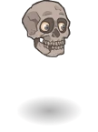
        
        
            Model
        
    

# Mortimer Rictusgrin

Whoever Mortimer Rictusgrin was in his mortal life hardly matters anymore. What remains of 'Morte' is a cheerful and chatty floating human skull of many talents. Once a companion of the Nameless One, he now helpfully guides newcomers around the city of Sigil in the Outlands, and confounds his unfortunate foes with acerbic taunts and a stubborn refusal to die.

# Basic Information

Mortimer Rictusgrin will be a new champion in the Feast of the Moon event on 4 November 2026.

  **Seat**:
  6
  **Stat**
  **Value**
  **Day 1 Trials**
  **Patrons**
  **Skylla Patrons**
  **Species**:
  Human
  **Strength**:
  12
  Yes
  Mirt
  Mirt
  **Class**:
  Fighter
  **Dexterity**:
  16
  Yes
  Vajra
  -
  **Roles**:
  Tanking / Support / Debuff
  **Constitution**:
  16
  Yes
  Strahd
  Strahd
  **Age**:
  400
  **Intelligence**:
  13
  Yes
  -
  -
  **Gender**:
  Male
  **Wisdom**:
  9
  -
  Elminster
  Elminster
  **Alignment**:
  Chaotic Good
  **Charisma**:
  6
  -
  &nbsp;
  
  **Affiliation**:
  -
  **Total**:
  72
  &nbsp;
  Champion ID:
  181

# Formation

    <svg xmlns="http://www.w3.org/2000/svg" id="Morte" fill="#aaa" data-formationName="Morte" data-campaignName="Feast of the Moon" width="338" height="120"><circle cx="175" cy="25" r="15"/><circle cx="175" cy="105" r="15"/><circle cx="135" cy="45" r="15"/><circle cx="135" cy="85" r="15"/><circle cx="95" cy="25" r="15"/><circle cx="95" cy="65" r="15"/><circle cx="55" cy="45" r="15"/><circle cx="55" cy="85" r="15"/><circle cx="15" cy="25" r="15"/><circle cx="15" cy="105" r="15"/><text x="205" y="25" fill="#dcdcdc" font-size="25" font-family="Arial" font-weight="bold">Morte</text><text x="205" y="65" fill="#dcdcdc" font-size="15" font-family="Arial" font-weight="bold">Feast of the Moon</text></svg>

# Attacks

 **Base Attack: Bite** (Melee)
> Morte floats out and bites a random enemy.  
> Cooldown: 6s (Cap 1.5s)

<em>Raw Data</em>

<pre>
{
    "id": 1007,
    "name": "Bite",
    "description": "Morte swiftly floats over to bite a random enemy.",
    "long_description": "Morte floats out and bites a random enemy.",
    "graphic_id": 0,
    "target": "random",
    "num_targets": 1,
    "aoe_radius": 0,
    "damage_modifier": 1,
    "cooldown": 6,
    "animations": [
        {
            "type": "melee_attack",
            "target_offset_x": -34,
            "start_frame": 6,
            "damage_frame": 8
        }
    ],
    "tags": [
        "melee"
    ],
    "damage_types": [
        "melee"
    ]
}
</pre>

 **Base Attack: Helpful Encouragement** (Melee)
> Morte floats over to your BUD-setting Champion, resets their base attack cooldown, and increases the damage of their next attack.  
> Cooldown: 6s (Cap 1.5s)

<em>Raw Data</em>

<pre>
{
    "id": 1009,
    "name": "Helpful Encouragement",
    "description": "Morte floats over to your BUD-setting Champions and 'encourages' them to attack faster and hit harder.",
    "long_description": "Morte floats over to your BUD-setting Champion, resets their base attack cooldown, and increases the damage of their next attack.",
    "graphic_id": 0,
    "target": "none",
    "num_targets": 1,
    "aoe_radius": 0,
    "damage_modifier": 1,
    "cooldown": 6,
    "animations": [
        {
            "type": "melee_attack",
            "no_damage_display": true,
            "animation_sequence_name": "idle",
            "alternate_charge_sequence": "idle",
            "force_count_for_bud": false,
            "charge_manually": true
        }
    ],
    "tags": [
        "melee"
    ],
    "damage_types": [
        "melee"
    ]
}
</pre>

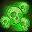 **Ultimate Attack: Skull Mob** (Level: 90)
> Morte summons an avalanche of his friends from the Bones of the Night to come and take a bite out of all enemies.  
> Cooldown: 240s (Cap 60s)

<em>Raw Data</em>

<pre>
{
    "id": 1008,
    "name": "Skull Mob",
    "description": "Morte summons an avalanche of his friends from the Bones of the Night to come and take a bite out of all enemies.",
    "long_description": "Morte summons an avalanche of his friends from the Bones of the Night to come and take a bite out of all enemies.",
    "graphic_id": 31400,
    "target": "all",
    "num_targets": 1,
    "aoe_radius": 0,
    "damage_modifier": 0.03,
    "cooldown": 240,
    "animations": [
        {
            "type": "morte_ultimate",
            "graphic_id": 31449
        }
    ],
    "tags": [
        "melee",
        "ultimate"
    ],
    "damage_types": [
        "melee"
    ]
}
</pre>

# Abilities

**Cutter of the Cage** (Level: 0)
> As a talking human skull, Morte is both Small and Undead, and counts as 'dead' for the purposes of effects that care about dead Champions, but 'alive' for all other purposes. In addition, Morte can be used in any Turn of Fortune's Wheel campaign adventure or variant, even if he would not normally be available to be used due to variant or patron restrictions.

<em>Raw Data</em>

<pre>
{
    "id": 20954,
    "hero_id": 181,
    "required_level": 0,
    "required_upgrade_id": 0,
    "upgrade_type": "unlock_ability",
    "effect": "effect_def,2972",
    "static_dps_mult": null,
    "default_enabled": 1,
    "name": "Cutter of the Cage"
}
{
    "id": 2972,
    "flavour_text": "",
    "description": {
        "desc": "As a talking human skull, Morte is both Small and Undead, and counts as 'dead' for the purposes of effects that care about dead Champions, but 'alive' for all other purposes. In addition, Morte can be used in any Turn of Fortune's Wheel campaign adventure or variant, even if he would not normally be available to be used due to variant or patron restrictions."
    },
    "effect_keys": [
        {
            "effect_string": "do_nothing,100"
        }
    ],
    "requirements": "",
    "graphic_id": 0,
    "large_graphic_id": 0,
    "properties": {
        "is_formation_ability": true,
        "owner_use_outgoing_description": true,
        "indexed_effect_properties": true,
        "per_effect_index_bonuses": true,
        "default_bonus_index": 0
    }
}
</pre>

 **Biting Wit** (Level: 20)
> Morte increases the damage of all Champions in the formation by 100%, increased by 100% for each Champion in the formation with the Debuff role.

ⓘ *Note: This ability is prestack.*

<em>Upgrade Data</em>

<pre>
Upgrades:
       80: 100%
      170: 100%
      270: 100%
      410: 100%
      570: 100%
      740: 100%
      900: 100%
    1,060: 100%
    1,220: 100%
    1,380: 100%
    1,540: 100%
    1,700: 100%
    1,850: 100%
    2,010: 100%
    2,170: 100%
    2,320: 100%
    2,490: 100%
    2,640: 100%
    2,800: 100%
    2,950: 100%
    3,050: 100%

    Total Upgrade Bonus: 2.10e08%
</pre>

<em>Raw Data</em>

<pre>
{
    "id": 20955,
    "hero_id": 181,
    "required_level": 20,
    "required_upgrade_id": 0,
    "upgrade_type": "unlock_ability",
    "effect": "effect_def,2973",
    "static_dps_mult": null,
    "default_enabled": 1,
    "name": "Biting Wit",
    "tip_text": "Morte buffs all Champions based on how many Champions with the Debuff role are in the formation, and enemies take more damage depending on how many debuffs they have."
}
{
    "id": 2973,
    "flavour_text": "",
    "description": {
        "desc": "Morte increases the damage of all Champions in the formation by $(amount)%, increased by $amount% for each Champion in the formation with the Debuff role."
    },
    "effect_keys": [
        {
            "effect_string": "pre_stack,100",
            "skip_effect_key_desc": true
        },
        {
            "effect_string": "hero_dps_multiplier_mult,0",
            "amount_expr": "upgrade_amount(20955,0)",
            "targets": [
                "all"
            ],
            "amount_updated_listeners": [
                "slot_changed",
                "hero_tags_changed"
            ],
            "off_when_benched": true,
            "desc_forced_order": 2,
            "show_bonus": true
        },
        {
            "effect_string": "buff_upgrade,100,20955,1",
            "off_when_benched": true,
            "desc_forced_order": 1,
            "amount_expr": "upgrade_amount(20955,0)",
            "amount_func": "mult",
            "stack_func": "per_hero_attribute",
            "per_hero_expr": "HasTag(`debuff`)",
            "show_bonus": true,
            "stack_title": "Debuff Champions",
            "total_title": "Debuff Champions Buff",
            "amount_updated_listeners": [
                "slot_changed",
                "hero_tags_changed"
            ]
        }
    ],
    "requirements": "",
    "graphic_id": 31388,
    "large_graphic_id": 31382,
    "properties": {
        "is_formation_ability": true,
        "owner_use_outgoing_description": true,
        "indexed_effect_properties": true,
        "per_effect_index_bonuses": true,
        "default_bonus_index": 0
    }
}
{
    "id": 21275,
    "hero_id": 181,
    "required_level": 80,
    "required_upgrade_id": 0,
    "upgrade_type": "upgrade_ability",
    "effect": "buff_upgrade,100,20955,1",
    "static_dps_mult": null,
    "default_enabled": 1,
    "name": ""
}
{
    "id": 21504,
    "hero_id": 181,
    "required_level": 170,
    "required_upgrade_id": 0,
    "upgrade_type": "upgrade_ability",
    "effect": "buff_upgrade,100,20955,1",
    "static_dps_mult": null,
    "default_enabled": 1,
    "name": ""
}
{
    "id": 21508,
    "hero_id": 181,
    "required_level": 270,
    "required_upgrade_id": 0,
    "upgrade_type": "upgrade_ability",
    "effect": "buff_upgrade,100,20955,1",
    "static_dps_mult": null,
    "default_enabled": 1,
    "name": ""
}
{
    "id": 21512,
    "hero_id": 181,
    "required_level": 410,
    "required_upgrade_id": 0,
    "upgrade_type": "upgrade_ability",
    "effect": "buff_upgrade,100,20955,1",
    "static_dps_mult": null,
    "default_enabled": 1,
    "name": ""
}
{
    "id": 21517,
    "hero_id": 181,
    "required_level": 570,
    "required_upgrade_id": 0,
    "upgrade_type": "upgrade_ability",
    "effect": "buff_upgrade,100,20955,1",
    "static_dps_mult": null,
    "default_enabled": 1,
    "name": ""
}
{
    "id": 21522,
    "hero_id": 181,
    "required_level": 740,
    "required_upgrade_id": 0,
    "upgrade_type": "upgrade_ability",
    "effect": "buff_upgrade,100,20955,1",
    "static_dps_mult": null,
    "default_enabled": 1,
    "name": ""
}
{
    "id": 21525,
    "hero_id": 181,
    "required_level": 900,
    "required_upgrade_id": 0,
    "upgrade_type": "upgrade_ability",
    "effect": "buff_upgrade,100,20955,1",
    "static_dps_mult": null,
    "default_enabled": 1,
    "name": ""
}
{
    "id": 21529,
    "hero_id": 181,
    "required_level": 1060,
    "required_upgrade_id": 0,
    "upgrade_type": "upgrade_ability",
    "effect": "buff_upgrade,100,20955,1",
    "static_dps_mult": null,
    "default_enabled": 1,
    "name": ""
}
{
    "id": 21532,
    "hero_id": 181,
    "required_level": 1220,
    "required_upgrade_id": 0,
    "upgrade_type": "upgrade_ability",
    "effect": "buff_upgrade,100,20955,1",
    "static_dps_mult": null,
    "default_enabled": 1,
    "name": ""
}
{
    "id": 21536,
    "hero_id": 181,
    "required_level": 1380,
    "required_upgrade_id": 0,
    "upgrade_type": "upgrade_ability",
    "effect": "buff_upgrade,100,20955,1",
    "static_dps_mult": null,
    "default_enabled": 1,
    "name": ""
}
{
    "id": 21539,
    "hero_id": 181,
    "required_level": 1540,
    "required_upgrade_id": 0,
    "upgrade_type": "upgrade_ability",
    "effect": "buff_upgrade,100,20955,1",
    "static_dps_mult": null,
    "default_enabled": 1,
    "name": ""
}
{
    "id": 21542,
    "hero_id": 181,
    "required_level": 1700,
    "required_upgrade_id": 0,
    "upgrade_type": "upgrade_ability",
    "effect": "buff_upgrade,100,20955,1",
    "static_dps_mult": null,
    "default_enabled": 1,
    "name": ""
}
{
    "id": 21546,
    "hero_id": 181,
    "required_level": 1850,
    "required_upgrade_id": 0,
    "upgrade_type": "upgrade_ability",
    "effect": "buff_upgrade,100,20955,1",
    "static_dps_mult": null,
    "default_enabled": 1,
    "name": ""
}
{
    "id": 21548,
    "hero_id": 181,
    "required_level": 2010,
    "required_upgrade_id": 0,
    "upgrade_type": "upgrade_ability",
    "effect": "buff_upgrade,100,20955,1",
    "static_dps_mult": null,
    "default_enabled": 1,
    "name": ""
}
{
    "id": 21551,
    "hero_id": 181,
    "required_level": 2170,
    "required_upgrade_id": 0,
    "upgrade_type": "upgrade_ability",
    "effect": "buff_upgrade,100,20955,1",
    "static_dps_mult": null,
    "default_enabled": 1,
    "name": ""
}
{
    "id": 21554,
    "hero_id": 181,
    "required_level": 2320,
    "required_upgrade_id": 0,
    "upgrade_type": "upgrade_ability",
    "effect": "buff_upgrade,100,20955,1",
    "static_dps_mult": null,
    "default_enabled": 1,
    "name": ""
}
{
    "id": 21555,
    "hero_id": 181,
    "required_level": 2490,
    "required_upgrade_id": 0,
    "upgrade_type": "upgrade_ability",
    "effect": "buff_upgrade,100,20955,1",
    "static_dps_mult": null,
    "default_enabled": 1,
    "name": ""
}
{
    "id": 21558,
    "hero_id": 181,
    "required_level": 2640,
    "required_upgrade_id": 0,
    "upgrade_type": "upgrade_ability",
    "effect": "buff_upgrade,100,20955,1",
    "static_dps_mult": null,
    "default_enabled": 1,
    "name": ""
}
{
    "id": 21560,
    "hero_id": 181,
    "required_level": 2800,
    "required_upgrade_id": 0,
    "upgrade_type": "upgrade_ability",
    "effect": "buff_upgrade,100,20955,1",
    "static_dps_mult": null,
    "default_enabled": 1,
    "name": ""
}
{
    "id": 21563,
    "hero_id": 181,
    "required_level": 2950,
    "required_upgrade_id": 0,
    "upgrade_type": "upgrade_ability",
    "effect": "buff_upgrade,100,20955,1",
    "static_dps_mult": null,
    "default_enabled": 1,
    "name": ""
}
{
    "id": 21566,
    "hero_id": 181,
    "required_level": 3050,
    "required_upgrade_id": 0,
    "upgrade_type": "upgrade_ability",
    "effect": "buff_upgrade,100,20955,1",
    "static_dps_mult": null,
    "default_enabled": 1,
    "name": ""
}
</pre>

 **Litany of Curses** (Level: 50)
> Morte causes enemies he attacks to take 100% additional damage for each Debuff affecting them (including this one), stacking multiplicatively. This can count at most 25 debuffs, does not stack itself, and lasts until the enemy dies.

<em>Raw Data</em>

<pre>
{
    "id": 20956,
    "hero_id": 181,
    "required_level": 50,
    "required_upgrade_id": 0,
    "upgrade_type": "unlock_ability",
    "effect": "effect_def,2974",
    "static_dps_mult": null,
    "default_enabled": 1,
    "name": "Litany of Curses"
}
{
    "id": 2974,
    "flavour_text": "",
    "description": {
        "pre": "Morte causes enemies he attacks to take $(amount)% additional damage for each Debuff affecting them (including this one), stacking multiplicatively. This can count at most $max_stacks debuffs, does not stack itself, and lasts until the enemy dies.",
        "post": {
            "conditions": [
                {
                    "condition": "not static_desc",
                    "desc": "^^Bonus damage at max stacks: $(morte_litany_of_curses_max_buff)%"
                }
            ]
        }
    },
    "effect_keys": [
        {
            "effect_string": "morte_litany_of_curses,100",
            "off_when_benched": true,
            "max_stacks": 25,
            "debuffing_attack_ids": [
                1007,
                1008
            ],
            "debuff_effects": [
                {
                    "effect_string": "increase_monster_damage_per_debuff_mult,$amount",
                    "active_graphic_id": 31533,
                    "active_graphic_y": -45,
                    "max_stacks": 25,
                    "use_collection_source": true
                }
            ],
            "debuff_before_damage": true,
            "show_bonus": true
        }
    ],
    "requirements": "",
    "graphic_id": 31392,
    "large_graphic_id": 31386,
    "properties": {
        "is_formation_ability": true,
        "owner_use_outgoing_description": true,
        "indexed_effect_properties": true,
        "per_effect_index_bonuses": true,
        "default_bonus_index": 0
    }
}
</pre>

 **Give 'em the Laugh** (Level: 70)
> Morte begins every area with stacks of Evasion equal to his overwhelm point. When Morte gets attacked (including "attacks" from the variant such as objects falling from the sky or cold/weather damage), as long as he has at least 1 stack of Evasion left, he dodges the attack completely and uses up 1 stack of Evasion. Morte restores 1 stack of Evasion every second for each Debuff Champion in the formation. The number of Evasion stacks he has can not surpass his overwhelm point. If a boss or enemies are enraged, max stacks are divided by the enrage multiplier, rounded down.

<em>Raw Data</em>

<pre>
{
    "id": 20957,
    "hero_id": 181,
    "required_level": 70,
    "required_upgrade_id": 0,
    "upgrade_type": "unlock_ability",
    "effect": "effect_def,2975",
    "static_dps_mult": null,
    "default_enabled": 1,
    "name": "Give 'em the Laugh",
    "tip_text": "Morte is very agile (for a skull) and can dodge attacks using his Evasion stacks. He restores Evasion stacks over time based on the number of Debuff Champions in the formation."
}
{
    "id": 2975,
    "flavour_text": "",
    "description": {
        "desc": "Morte begins every area with stacks of Evasion equal to his overwhelm point. When Morte gets attacked (including \"attacks\" from the variant such as objects falling from the sky or cold/weather damage), as long as he has at least 1 stack of Evasion left, he dodges the attack completely and uses up $stacks_to_use stack of Evasion. Morte restores $stacks_to_restore stack of Evasion every second for each Debuff Champion in the formation. The number of Evasion stacks he has can not surpass his overwhelm point. If a boss or enemies are enraged, max stacks are divided by the enrage multiplier, rounded down."
    },
    "effect_keys": [
        {
            "effect_string": "morte_give_em_the_laugh",
            "manual_stacking": true,
            "show_stacks": true,
            "start_pre_add": 0,
            "start_mult": 1,
            "start_post_add": 0,
            "stacks_to_trigger": 1,
            "stacks_to_use": 1,
            "evasion_effect": {
                "effect_string": "evade_damage"
            },
            "stacks_to_restore": 1,
            "restore_time": 1,
            "stack_func_data": {
                "target_filters": [
                    {
                        "type": "tags",
                        "tags": "debuff"
                    }
                ]
            },
            "enrage_pre_add": 0,
            "enrage_mult": 1,
            "enrage_post_add": 0,
            "overlay_graphic_id": 31447,
            "broadcast_name": "morte_evasion"
        }
    ],
    "requirements": "",
    "graphic_id": 31390,
    "large_graphic_id": 31384,
    "properties": {
        "is_formation_ability": true,
        "owner_use_outgoing_description": true,
        "indexed_effect_properties": true,
        "per_effect_index_bonuses": true,
        "show_outgoing_desc_when_benched": false,
        "default_bonus_index": 0
    }
}
</pre>

 **Don't Trust the Skull** (Level: 110)
> Morte gains 5 Overwhelm for each Champion in the formation who does not have the Debuff role.

<em>Raw Data</em>

<pre>
{
    "id": 20958,
    "hero_id": 181,
    "required_level": 110,
    "required_upgrade_id": 0,
    "upgrade_type": "unlock_ability",
    "effect": "effect_def,2976",
    "static_dps_mult": null,
    "default_enabled": 1,
    "name": "Don't Trust the Skull"
}
{
    "id": 2976,
    "flavour_text": "",
    "description": {
        "desc": "Morte gains $amount Overwhelm for each Champion in the formation who does not have the Debuff role."
    },
    "effect_keys": [
        {
            "effect_string": "overwhelm_start_increase,5",
            "off_when_benched": true,
            "amount_func": "add",
            "stack_func": "per_hero_attribute",
            "per_hero_expr": "!HasTag(`debuff`)",
            "per_hero_targets": [
                "all"
            ],
            "show_bonus": true,
            "stack_title": "Non Debuff Champions",
            "total_title": "Total Additional Overwhelm",
            "percent_values": false,
            "amount_updated_listeners": [
                "slot_changed",
                "hero_tags_changed"
            ]
        }
    ],
    "requirements": "",
    "graphic_id": 31389,
    "large_graphic_id": 31383,
    "properties": {
        "is_formation_ability": true,
        "owner_use_outgoing_description": true,
        "indexed_effect_properties": true,
        "per_effect_index_bonuses": true,
        "default_bonus_index": 0
    }
}
</pre>

 **Heads Up, Chief!** (Level: 150)
> When he has at least 1 stack of Evasion and is in the front-most column of the formation, Morte reduces the damage taken by all other Champions in the formation by 75%. Regardless of his position in the formation, if Morte has at least 40 Evasion stacks, and any Champion other than Morte is defeated, Morte instantly expends 40 Evasion stacks and revives that Champion at full health.

<em>Raw Data</em>

<pre>
{
    "id": 20959,
    "hero_id": 181,
    "required_level": 150,
    "required_upgrade_id": 0,
    "upgrade_type": "unlock_ability",
    "effect": "effect_def,2977",
    "static_dps_mult": null,
    "default_enabled": 1,
    "name": "Heads Up, Chief!"
}
{
    "id": 2977,
    "flavour_text": "",
    "description": {
        "desc": "When he has at least $if_amount___2 stack of Evasion and is in the front-most column of the formation, Morte reduces the damage taken by all other Champions in the formation by $amount___2%. Regardless of his position in the formation, if Morte has at least 40 Evasion stacks, and any Champion other than Morte is defeated, Morte instantly expends 40 Evasion stacks and revives that Champion at full health."
    },
    "effect_keys": [
        {
            "effect_string": "apply_effects_at_stacks",
            "show_description": false,
            "apply_effect_stack_amounts": [
                1
            ],
            "show_stacks": false,
            "stacks_are_bonus": false,
            "stacks_from_amount_func": "per_crusader",
            "target_filters": [
                {
                    "type": "hero_expr",
                    "per_hero_expr": "hero_id == 181 && GetHeroColumn(181) == 0"
                }
            ],
            "amount_updated_listeners": [
                "slot_changed"
            ],
            "off_when_benched": true,
            "show_bonus": false
        },
        {
            "effect_string": "damage_reduction,75",
            "apply_manually": true,
            "off_when_benched": true,
            "targets": [
                "other"
            ],
            "amount_func": "if",
            "if_amount": 1,
            "stack_func": "upgrade_stacks",
            "stack_func_data": {
                "upgrade_id": 20957
            },
            "amount_updated_listeners": [
                "hero_killed"
            ],
            "show_stacks": true,
            "stack_title": "Current Evasion Stacks",
            "use_computed_amount_for_description": true
        }
    ],
    "requirements": "",
    "graphic_id": 31391,
    "large_graphic_id": 31385,
    "properties": {
        "is_formation_ability": true,
        "owner_use_outgoing_description": true,
        "indexed_effect_properties": true,
        "per_effect_index_bonuses": true,
        "default_bonus_index": 1
    }
}
</pre>

 **Planar Traveler** (Level: 220)
> Morte increases the effect of Biting Wit by 20% for each adventure, variant, and Patron variant you have completed in the Turn of Fortune's Wheel campaign, stacking multiplicatively.

<em>Raw Data</em>

<pre>
{
    "id": 20960,
    "hero_id": 181,
    "required_level": 220,
    "required_upgrade_id": 0,
    "upgrade_type": "unlock_ability",
    "effect": "effect_def,2978",
    "static_dps_mult": null,
    "default_enabled": 1,
    "name": "Planar Traveler"
}
{
    "id": 2978,
    "flavour_text": "",
    "description": {
        "desc": "Morte increases the effect of Biting Wit by $(not_buffed amount)% for each adventure, variant, and Patron variant you have completed in the Turn of Fortune's Wheel campaign, stacking multiplicatively."
    },
    "effect_keys": [
        {
            "off_when_benched": true,
            "effect_string": "buff_upgrade,20,20955,1",
            "stacks_multiply": true,
            "show_bonus": true,
            "amount_func": "mult",
            "stack_func": "get_stat",
            "stat": "FortunesWheelAdventuresCompleted",
            "ided_stat_id": 29,
            "ided_stat_handler": "CompletedAdventuresVariantsAndPatronVariants",
            "stack_title": "Fortune's Wheel Adventures Completed",
            "amount_updated_listeners": [
                "stat_changed,FortunesWheelAdventuresCompleted"
            ]
        }
    ],
    "requirements": "",
    "graphic_id": 31393,
    "large_graphic_id": 31387,
    "properties": {
        "is_formation_ability": true,
        "owner_use_outgoing_description": true,
        "indexed_effect_properties": true,
        "per_effect_index_bonuses": true,
        "default_bonus_index": 0
    }
}
</pre>

# Specialisations

 **Floating Flirt** (Level: 130)
> Morte increases the effect of Biting Wit by 100% for each Female or Non-Binary Champion in the formation, stacking multiplicatively.

<em>Raw Data</em>

<pre>
{
    "id": 20961,
    "hero_id": 181,
    "required_level": 130,
    "required_upgrade_id": 0,
    "upgrade_type": "unlock_ability",
    "effect": "effect_def,2979",
    "static_dps_mult": null,
    "default_enabled": 1,
    "name": "Floating Flirt",
    "specialization_name": "Floating Flirt",
    "specialization_description": "This cadaverous casanova does his best to impress certain members of the adventuring party.",
    "specialization_graphic_id": 31396
}
{
    "id": 2979,
    "flavour_text": "",
    "description": {
        "desc": "Morte increases the effect of Biting Wit by $(not_buffed amount)% for each Female or Non-Binary Champion in the formation, stacking multiplicatively."
    },
    "effect_keys": [
        {
            "off_when_benched": true,
            "effect_string": "buff_upgrade,100,20955,1",
            "stacks_multiply": true,
            "amount_func": "mult",
            "stack_func": "per_hero_attribute",
            "per_hero_expr": "HasTag(`female`) || HasTag(`non_binary`)",
            "show_bonus": true,
            "stack_title": "Qualified Champions",
            "amount_updated_listeners": [
                "slot_changed",
                "hero_tags_changed"
            ]
        }
    ],
    "requirements": "",
    "graphic_id": 31396,
    "large_graphic_id": 31396,
    "properties": {
        "is_formation_ability": true,
        "owner_use_outgoing_description": true,
        "indexed_effect_properties": true,
        "per_effect_index_bonuses": true,
        "default_bonus_index": 0,
        "spec_option_post_apply_info": "Qualified Champions: $num_stacks"
    }
}
</pre>

 **Misfits of the Maze** (Level: 130)
> Morte increases the effect of Biting Wit by 100% for each Champion in the formation who is Undead or a Non-Standard Species, stacking multiplicatively. Standard species are Aasimar, Dragonborn, Dwarf, Elf, Gnome, Goliath, Halfling, Human, Orc, Tiefling, Half-Orc, and Half-Elf.

<em>Raw Data</em>

<pre>
{
    "id": 20962,
    "hero_id": 181,
    "required_level": 130,
    "required_upgrade_id": 0,
    "upgrade_type": "unlock_ability",
    "effect": "effect_def,2980",
    "static_dps_mult": null,
    "default_enabled": 1,
    "name": "Misfits of the Maze",
    "specialization_name": "Misfits of the Maze",
    "specialization_description": "This canny crusader feels right at home among fellow outcasts of the Outlands.",
    "specialization_graphic_id": 31398
}
{
    "id": 2980,
    "flavour_text": "",
    "description": {
        "desc": "Morte increases the effect of Biting Wit by $(not_buffed amount)% for each Champion in the formation who is Undead or a Non-Standard Species, stacking multiplicatively. Standard species are Aasimar, Dragonborn, Dwarf, Elf, Gnome, Goliath, Halfling, Human, Orc, Tiefling, Half-Orc, and Half-Elf."
    },
    "effect_keys": [
        {
            "off_when_benched": true,
            "effect_string": "buff_upgrade,100,20955,1",
            "stacks_multiply": true,
            "amount_func": "mult",
            "stack_func": "per_hero_attribute",
            "per_hero_expr": "HasTag(`undead`) || has_non_standard_race",
            "show_bonus": true,
            "stack_title": "Qualified Champions",
            "amount_updated_listeners": [
                "slot_changed",
                "hero_tags_changed"
            ]
        }
    ],
    "requirements": "",
    "graphic_id": 31398,
    "large_graphic_id": 31398,
    "properties": {
        "is_formation_ability": true,
        "owner_use_outgoing_description": true,
        "indexed_effect_properties": true,
        "per_effect_index_bonuses": true,
        "default_bonus_index": 0,
        "spec_option_post_apply_info": "Qualified Champions: $num_stacks"
    }
}
</pre>

 **Cross-Trade Companions** (Level: 130)
> Morte increases the effect of Biting Wit by 100% for each Champion in the formation who is a Rogue, Evil, or Chaotic, stacking multiplicatively.

<em>Raw Data</em>

<pre>
{
    "id": 20963,
    "hero_id": 181,
    "required_level": 130,
    "required_upgrade_id": 0,
    "upgrade_type": "unlock_ability",
    "effect": "effect_def,2981",
    "static_dps_mult": null,
    "default_enabled": 1,
    "name": "Cross-Trade Companions",
    "specialization_name": "Cross-Trade Companions",
    "specialization_description": "This criminal cranium has friends among the Lower Ward of Sigil.",
    "specialization_graphic_id": 31394
}
{
    "id": 2981,
    "flavour_text": "",
    "description": {
        "desc": "Morte increases the effect of Biting Wit by $(not_buffed amount)% for each Champion in the formation who is a Rogue, Evil, or Chaotic, stacking multiplicatively."
    },
    "effect_keys": [
        {
            "off_when_benched": true,
            "effect_string": "buff_upgrade,100,20955,1",
            "stacks_multiply": true,
            "amount_func": "mult",
            "stack_func": "per_hero_attribute",
            "per_hero_expr": "HasTag(`rogue`) || HasTag(`evil`) || HasTag(`chaotic`)",
            "show_bonus": true,
            "stack_title": "Qualified Champions",
            "amount_updated_listeners": [
                "slot_changed",
                "hero_tags_changed"
            ]
        }
    ],
    "requirements": "",
    "graphic_id": 31394,
    "large_graphic_id": 31394,
    "properties": {
        "is_formation_ability": true,
        "owner_use_outgoing_description": true,
        "indexed_effect_properties": true,
        "per_effect_index_bonuses": true,
        "default_bonus_index": 0,
        "spec_option_post_apply_info": "Qualified Champions: $num_stacks"
    }
}
</pre>

 **What's Eatin' You, Chief?** (Level: 180)
> Morte's base attack no longer targets enemies; instead, he zips over to your BUD-setting Champion and provides helpful encouragement, instantly resetting their base attack cooldown and increasing the damage of their next attack by 1000%. If Morte himself is the BUD-setting Champion, he gets confused and does nothing.

<em>Raw Data</em>

<pre>
{
    "id": 20964,
    "hero_id": 181,
    "required_level": 180,
    "required_upgrade_id": 0,
    "upgrade_type": "unlock_ability",
    "effect": "effect_def,2982",
    "static_dps_mult": null,
    "default_enabled": 1,
    "name": "What's Eatin' You, Chief?",
    "specialization_name": "What's Eatin' You, Chief?",
    "specialization_description": "Morte is never far from 'The Chief,' helping to 'motivate' them along on their adventures together in any way he can.",
    "specialization_graphic_id": 31399
}
{
    "id": 2982,
    "flavour_text": "",
    "description": {
        "desc": "Morte's base attack no longer targets enemies; instead, he zips over to your BUD-setting Champion and provides helpful encouragement, instantly resetting their base attack cooldown and increasing the damage of their next attack by $amount%. If Morte himself is the BUD-setting Champion, he gets confused and does nothing."
    },
    "effect_keys": [
        {
            "effect_string": "morte_whats_eatin_you_chief_handler,1000",
            "off_when_benched": true,
            "buff_effect": {
                "effect_string": "next_attack_damage_multiplier,0"
            }
        },
        {
            "effect_string": "change_base_attack,1009"
        }
    ],
    "requirements": "",
    "graphic_id": 31399,
    "large_graphic_id": 31399,
    "properties": {
        "is_formation_ability": true,
        "owner_use_outgoing_description": true,
        "indexed_effect_properties": true,
        "per_effect_index_bonuses": true,
        "default_bonus_index": 0
    }
}
</pre>

 **Dodgy Tactics** (Level: 180)
> Morte requires and consumes twice as many Evasion stacks when he dodges an attack, but the base effect of Litany of Curses is increased by 10% for 5 seconds after he does so. Does not stack, but the timer resets if he dodges again before it expires.

ⓘ *Note: This ability is prestack.*

<em>Raw Data</em>

<pre>
{
    "id": 20965,
    "hero_id": 181,
    "required_level": 180,
    "required_upgrade_id": 0,
    "upgrade_type": "unlock_ability",
    "effect": "effect_def,2983",
    "static_dps_mult": null,
    "default_enabled": 1,
    "name": "Dodgy Tactics",
    "specialization_name": "Dodgy Tactics",
    "specialization_description": "Morte puts a little more thought into crafting creative insults at the risk of becoming distracted while dodging.",
    "specialization_graphic_id": 31395
}
{
    "id": 2983,
    "flavour_text": "",
    "description": {
        "desc": "Morte requires and consumes twice as many Evasion stacks when he dodges an attack, but the base effect of Litany of Curses is increased by $amount___3% for $time___2 seconds after he does so. Does not stack, but the timer resets if he dodges again before it expires."
    },
    "effect_keys": [
        {
            "effect_string": "change_upgrade_data,20957",
            "off_when_benched": true,
            "data": {
                "stacks_to_trigger": 2,
                "stacks_to_use": 2
            }
        },
        {
            "effect_string": "morte_dodgy_tactics_handler",
            "off_when_benched": true,
            "buff_index": 3,
            "time": 5,
            "broadcast_name": "morte_evasion"
        },
        {
            "effect_string": "pre_stack,10",
            "skip_effect_key_desc": true
        },
        {
            "effect_string": "buff_upgrade,10,20956,0",
            "off_when_benched": true,
            "amount_expr": "upgrade_amount(20965,2)",
            "apply_manually": true
        }
    ],
    "requirements": "",
    "graphic_id": 31395,
    "large_graphic_id": 31395,
    "properties": {
        "is_formation_ability": true,
        "owner_use_outgoing_description": true,
        "indexed_effect_properties": true,
        "per_effect_index_bonuses": true,
        "default_bonus_index": 2
    }
}
</pre>

 **Laughing Skull** (Level: 180)
> When any Champion (including Morte) is attacked but takes no damage, Morte mocks the enemy that attacked that Champion, increasing the damage that enemy takes by 100%. If Morte mocks the same enemy multiple times, the effect applies up to 10 times per enemy, stacking multiplicatively.

ⓘ *Note: This ability is prestack.*

<em>Raw Data</em>

<pre>
{
    "id": 20966,
    "hero_id": 181,
    "required_level": 180,
    "required_upgrade_id": 0,
    "upgrade_type": "unlock_ability",
    "effect": "effect_def,2984",
    "static_dps_mult": null,
    "default_enabled": 1,
    "name": "Laughing Skull",
    "specialization_name": "Laughing Skull",
    "specialization_description": "Morte cackles at the enemy's pathetic attempts to stop him and his friends from venturing forth.",
    "specialization_graphic_id": 31397
}
{
    "id": 2984,
    "flavour_text": "",
    "description": {
        "desc": "When any Champion (including Morte) is attacked but takes no damage, Morte mocks the enemy that attacked that Champion, increasing the damage that enemy takes by $amount%. If Morte mocks the same enemy multiple times, the effect applies up to 10 times per enemy, stacking multiplicatively."
    },
    "effect_keys": [
        {
            "effect_string": "pre_stack,100",
            "skip_effect_key_desc": true
        },
        {
            "effect_string": "morte_laughing_skull,0",
            "off_when_benched": true,
            "debuff_effects": [
                {
                    "effect_string": "increase_monster_damage,0",
                    "amount_expr": "upgrade_amount(20966,0)",
                    "active_graphic_id": 31544,
                    "active_graphic_y": -125,
                    "max_stacks": 10,
                    "stacks_on_reapply": true,
                    "manual_stacking": true,
                    "stacks_multiply": true,
                    "stack_count_debug": true,
                    "use_collection_source": false,
                    "stack_across_effects": false
                }
            ]
        }
    ],
    "requirements": "",
    "graphic_id": 31397,
    "large_graphic_id": 31397,
    "properties": {
        "is_formation_ability": true,
        "owner_use_outgoing_description": true,
        "indexed_effect_properties": true,
        "per_effect_index_bonuses": true,
        "default_bonus_index": 0,
        "retain_on_slot_changed": true
    }
}
</pre>

# Items

    
        
            **Icons**
        
        
            **Slot**
        
        
            **Epic Name**
        
        
            **Effect**
        
    
    
        
            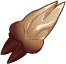ID: 4394**Teeth of the Viper**The poison's useful, sure, but it makes me look like I'm drooling!  Increases the effect of Morte's Biting Wit ability by 10%. (Prestack)<code>buff_upgrade,10,20955 allow_ge:true</code>ID: 4395**Teeth of the Fire Drake**Unless you've suddenly become a dentist, hands off! You'll get burned.  Increases the effect of Morte's Biting Wit ability by 30%. (Prestack)<code>buff_upgrade,30,20955 allow_ge:true</code>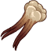ID: 4396**Fiend's Teeth**Huh. That's weird. I don't remember how I got these.  Increases the effect of Morte's Biting Wit ability by 50%. (Prestack)<code>buff_upgrade,50,20955 allow_ge:true</code>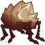ID: 4397**Ingress' Teeth**Careful, Chief. One nick from these and you'll wish you were a deader.  Increases the effect of Morte's Biting Wit ability by 100%. (Prestack)<code>buff_upgrade,100,20955 allow_ge:true</code>&nbsp;
        
        
            1
        
        
            Ingress' Teeth
        
        
            Increases the effect of Morte's Biting Wit ability by 100%. (Prestack)
        
    
    
        
            ID: 4398**Tired Gibes**Ugh, this flam's not worth my time. It's just so... common.  Increases the effect of Morte's Litany of Curses ability by 25%.<code>buff_upgrade,25,20956 allow_ge:true</code>ID: 4399**Quality Quips**I've updated my journal! Er, I mean, my repertoire of insults...  Increases the effect of Morte's Litany of Curses ability by 87.5%.<code>buff_upgrade,87.5,20956 allow_ge:true</code>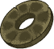ID: 4400**Unbroken Circle of Zerthimon**It's a stuffy read, if you can even manage it. You a graybeard, Chief?  Increases the effect of Morte's Litany of Curses ability by 150%.<code>buff_upgrade,150,20956 allow_ge:true</code>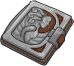ID: 4401**Fall-from-Grace's Diary**Finally! ...Locked!? You know, sometimes I sure miss having a body.  Increases the effect of Morte's Litany of Curses ability by 275%.<code>buff_upgrade,275,20956 allow_ge:true</code>&nbsp;
        
        
            2
        
        
            Fall-from-Grace's Diary
        
        
            Increases the effect of Morte's Litany of Curses ability by 275%.
        
    
    
        
            ID: 4402**Mortuary Dross**Just some awful offal some deader left behind. Worthless.  Increases the effect of Morte's Planar Traveler ability by 25%.<code>buff_upgrade,25,20960 allow_ge:false</code>ID: 4403**Xachariah's Remains**Yeah, I remember him. Called me a smart mouth! I mean, he was right, but still.  Increases the effect of Morte's Planar Traveler ability by 87.5%.<code>buff_upgrade,87.5,20960 allow_ge:false</code>ID: 4404**Deionarra's Wedding Ring**Now there's a sob story. Love and practicality don't mix, Chief.  Increases the effect of Morte's Planar Traveler ability by 150%.<code>buff_upgrade,150,20960 allow_ge:false</code>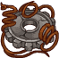ID: 4405**Twisted Gear of Enoll Eva**This thing? Just some junk that fell out of a cube that talks to his crossbows.  Increases the effect of Morte's Planar Traveler ability by 275%.<code>buff_upgrade,275,20960 allow_ge:false</code>&nbsp;
        
        
            3
        
        
            Twisted Gear of Enoll Eva
        
        
            Increases the effect of Morte's Planar Traveler ability by 275%.
        
    
    
        
            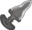ID: 4406**Jagged Edge**You need a weapon if you want to survive the Cage for long, Chief. Take this.  Increases the effect of Morte's first set of Specializations by 25%.<code>buff_upgrades,25,20961,20962,20963 allow_ge:false</code>ID: 4407**Annah's Punch Dagger**There's a feisty fiendling with an accent who's gonna want that back, Chief.  Increases the effect of Morte's first set of Specializations by 87.5%.<code>buff_upgrades,87.5,20961,20962,20963 allow_ge:false</code>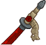ID: 4408**Dak'kon's Zerth Blade**This belonged to a gith. Silent type. Hard to trust. I knew him well.  Increases the effect of Morte's first set of Specializations by 150%.<code>buff_upgrades,150,20961,20962,20963 allow_ge:false</code>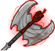ID: 4409**Vhailor's Final Judgement**Oh, sure, I'll just, uh, swing it with my arms. That I have.  Increases the effect of Morte's first set of Specializations by 275%.<code>buff_upgrades,275,20961,20962,20963 allow_ge:false</code>&nbsp;
        
        
            4
        
        
            Vhailor's Final Judgement
        
        
            Increases the effect of Morte's first set of Specializations by 275%.
        
    
    
        
            ID: 4410**False Advertisement**Directions are wrong. Some rube's bound to get peeled.  Increases the effect of Morte's second set of Specializations by 10%. (Prestack)<code>buff_upgrades,10,20964,20965,20966 allow_ge:false</code>ID: 4411**Fell Pamphlet**Fell's a real blood of a tattoo artist, and well-lanned. Nice case, too.  Increases the effect of Morte's second set of Specializations by 30%. (Prestack)<code>buff_upgrades,30,20964,20965,20966 allow_ge:false</code>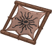ID: 4412**Tattoo of Ignus**That sod? Barmy basher. A real candle burning at both ends, you get me?  Increases the effect of Morte's second set of Specializations by 50%. (Prestack)<code>buff_upgrades,50,20964,20965,20966 allow_ge:false</code>ID: 4413**Tattoo of the Skull**Now there's a mark! Rigor mortis has never looked so good!  Increases the effect of Morte's second set of Specializations by 100%. (Prestack)<code>buff_upgrades,100,20964,20965,20966 allow_ge:false</code>&nbsp;
        
        
            5
        
        
            Tattoo of the Skull
        
        
            Increases the effect of Morte's second set of Specializations by 100%. (Prestack)
        
    
    
        
            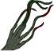ID: 4414**Black Barbs**That's got to be one of the ugliest things I've ever seen.  Reduces the cooldown on Morte's Ultimate Attack by 6 seconds.<code>reduce_ultimate_cooldown,6 allow_ge:false</code>ID: 4415**Ravel's Fingernails**Let's find a way out of here before this place grows on us, okay? Literally.  Reduces the cooldown on Morte's Ultimate Attack by 12 seconds.<code>reduce_ultimate_cooldown,12 allow_ge:false</code>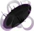ID: 4416**Negative Token**Shadows... Don't listen to 'em, Chief. They're not you.  Reduces the cooldown on Morte's Ultimate Attack by 24 seconds.<code>reduce_ultimate_cooldown,24 allow_ge:false</code>ID: 4417**Morte's Planar Parade**I'll tell you what's what from here on out. Trust me!  Reduces the cooldown on Morte's Ultimate Attack by 60 seconds.<code>reduce_ultimate_cooldown,60 allow_ge:false</code>&nbsp;
        
        
            6
        
        
            Morte's Planar Parade
        
        
            Reduces the cooldown on Morte's Ultimate Attack by 60 seconds. Cap: 501 dull / 251 shiny / 126 golden.
        
    

<em>Item Names and Descriptions</em>

<pre>
Slot 1:
     Teeth of the Fire Drake: Unless you've suddenly become a dentist, hands off! You'll get
                              burned.
          Teeth of the Viper: The poison's useful, sure, but it makes me look like I'm
                              drooling!
               Fiend's Teeth: Huh. That's weird. I don't remember how I got these.
              Ingress' Teeth: Careful, Chief. One nick from these and you'll wish you were a
                              deader.

Slot 2:
                 Tired Gibes: Ugh, this flam's not worth my time. It's just so... common.
               Quality Quips: I've updated my journal! Er, I mean, my repertoire of insults...
Unbroken Circle of Zerthimon: It's a stuffy read, if you can even manage it. You a graybeard,
                              Chief?
     Fall-from-Grace's Diary: Finally! ...Locked!? You know, sometimes I sure miss having a
                              body.

Slot 3:
              Mortuary Dross: Just some awful offal some deader left behind. Worthless.
         Xachariah's Remains: Yeah, I remember him. Called me a smart mouth! I mean, he was
                              right, but still.
    Deionarra's Wedding Ring: Now there's a sob story. Love and practicality don't mix, Chief.
   Twisted Gear of Enoll Eva: This thing? Just some junk that fell out of a cube that talks to
                              his crossbows.

Slot 4:
                 Jagged Edge: You need a weapon if you want to survive the Cage for long,
                              Chief. Take this.
        Annah's Punch Dagger: There's a feisty fiendling with an accent who's gonna want that
                              back, Chief.
       Dak'kon's Zerth Blade: This belonged to a gith. Silent type. Hard to trust. I knew him
                              well.
   Vhailor's Final Judgement: Oh, sure, I'll just, uh, swing it with my arms. That I have.

Slot 5:
         False Advertisement: Directions are wrong. Some rube's bound to get peeled.
               Fell Pamphlet: Fell's a real blood of a tattoo artist, and well-lanned. Nice
                              case, too.
             Tattoo of Ignus: That sod? Barmy basher. A real candle burning at both ends, you
                              get me?
         Tattoo of the Skull: Now there's a mark! Rigor mortis has never looked so good!

Slot 6:
                 Black Barbs: That's got to be one of the ugliest things I've ever seen.
         Ravel's Fingernails: Let's find a way out of here before this place grows on us, okay?
                              Literally.
              Negative Token: Shadows... Don't listen to 'em, Chief. They're not you.
       Morte's Planar Parade: I'll tell you what's what from here on out. Trust me!
</pre>

 

# Feats

This list will only show feats that are going to be available on the release of this champion. The separate [Feats](feats.md){:target="_blank"} page may show others that could be available later if they exist.

    
        
            **Feat**
        
        
            **Effect**
        
        
            **Source**
        
    
    
        
            ID: 2806**Selflessness (Morte)**Welcome back, Chief.<code>global_dps_multiplier_mult,10</code>Selflessness
        
        
            All Champions damage +10%.
        
        
            Free
        
    
    
        
            ID: 2807**Inspiring Leader (Morte)**Chief, I won't fail you again, I swear.<code>global_dps_multiplier_mult,25</code>Inspiring Leader
        
        
            All Champions damage +25%.
        
        
            Gold Chest
        
    
    
        
            ID: 2808**Defensive Duelist (Morte)**Ha! Try again, berk! I'll hold real still this time, promise.<code>overwhelm_start_increase,5</code>Defensive Duelist
        
        
            Morte takes 5 more Enemies attacking to get overwhelmed.
        
        
            Free
        
    
    
        
            ID: 2809**Calm Under Pressure (Morte)**I won't let you down, Chief.<code>overwhelm_start_increase,10</code>Calm Under Pressure
        
        
            Morte takes 10 more Enemies attacking to get overwhelmed.
        
        
            12,500 Gems
        
    
    
        
            ID: 2810**Crude Cadaver (Morte)**If I were you, I'd learn to latch your bone-box, skull. ~Annah<code>buff_upgrade,40,20955</code>Crude Cadaver
        
        
            Increases the effect of Morte's Biting Wit ability by 40%. (Prestack)
        
        
            Gold Chest
        
    
    
        
            ID: 2811**Bawdy Bone-Box (Morte)**Oh, Morte. Do you ever tire of being improper? ~Fall-from-Grace<code>buff_upgrade,80,20955</code>Bawdy Bone-Box
        
        
            Increases the effect of Morte's Biting Wit ability by 80%. (Prestack)
        
        
            50,000 Gems
        
    
    
        
            ID: 2812**Old Habits (Morte)**I haven't had this much fun since, uh... the last time.<code>buff_upgrade,20,20956</code>Old Habits
        
        
            Increases the effect of Morte's Litany of Curses ability by 20%.
        
        
            Free
        
    
    
        
            ID: 2813**New Taunts (Morte)**All right!<code>buff_upgrade,40,20956</code>New Taunts
        
        
            Increases the effect of Morte's Litany of Curses ability by 40%.
        
        
            12,500 Gems
        
    
    
        
            ID: 2814**Tout About Town (Morte)**Welcome to the Planes, Chief! First lesson: do as I say. You'll live longer.<code>buff_upgrade,40,20960</code>Tout About Town
        
        
            Increases the effect of Morte's Planar Traveler ability by 40%.
        
        
            Gold Chest
        
    
    
        
            ID: 2815**Chant of Torment (Morte)**Let me tell you about how I learned what can change the nature of a man...<code>buff_upgrade,80,20960</code>Chant of Torment
        
        
            Increases the effect of Morte's Planar Traveler ability by 80%.
        
        
            Event Bonus
        
    
    
        
            ID: 2816**Uneasy Alliance (Morte)**You do not engender trust in me, skull. ~Vhailor<code>buff_upgrades,20,20961,20962,20963</code>Uneasy Alliance
        
        
            Increases the effect of Morte's first set of Specializations by 20%.
        
        
            Free
        
    
    
        
            ID: 2817**Almost Friends (Morte)**Attention: Morte. Have we achieved a state of friendly camaraderie yet? ~Nordom<code>buff_upgrades,40,20961,20962,20963</code>Almost Friends
        
        
            Increases the effect of Morte's first set of Specializations by 40%.
        
        
            Gold Chest
        
    
    
        
            ID: 2818**First Impression (Morte)**You okay, Chief? You playing corpse or you putting the blinds on the Dusties?<code>buff_upgrades,40,20964,20965,20966</code>First Impression
        
        
            Increases the effect of Morte's second set of Specializations by 40%. (Prestack)
        
        
            12,500 Gems
        
    
    
        
            ID: 2819**Taunt (Morte)**You've got a face only a sledgehammer could love... And HAS!<code>global_dps_multiplier_mult,100 taunt,50</code>Taunt
        
        
            All Champions damage +100%. Morte's attacks have a 50% chance to taunt enemies.
        
        
            Event Bonus
        
    

# Legendaries

* Increases the damage of all Champions by 100%.
* Increases the damage of all Male Champions by 125%.
* Increases the damage of all Champions by 30% for each Champion with a CON score of 13 or higher in the formation.
* Increases the damage of all Champions by 20% for each Champion in the formation with a CHAOTIC alignment.
* Increases the damage of all Champions by 20% for each Champion in the formation with a GOOD alignment.
* Increases the damage of all Champions by 30% for each Magic Champion in the formation.

<em>DPS Applicable</em>

<pre>
         Arkhan: 5 / 6
        Artemis: 5 / 6
          Azaka: 4 / 6
         Binwin: 5 / 6
       Birdsong: 4 / 6
    Black Viper: 4 / 6
          Bobby: 5 / 6
     Catti-brie: 4 / 6
         Cazrin: 5 / 6
         D'hani: 4 / 6
      Dark Urge: 5 / 6 (Potentially 6 / 6)
         Delina: 5 / 6
        Dhadius: 6 / 6
         Drizzt: 5 / 6
        Farideh: 5 / 6
          Grimm: 5 / 6
         Gromma: 5 / 6
           Ishi: 4 / 6
        Jaheira: 4 / 6
        Jamilah: 4 / 6
       Jarlaxle: 5 / 6
            Jim: 6 / 6
        Karlach: 4 / 6
           Kent: 5 / 6
King of Shadows: 5 / 6 (Potentially 6 / 6)
           Krux: 5 / 6
        Lae'zel: 4 / 6 (Potentially 5 / 6)
         Lucius: 6 / 6
          Makos: 6 / 6
          Minsc: 5 / 6
          NERDS: 4 / 6 (Potentially 5 / 6)
         Nahara: 5 / 6
          Nixie: 5 / 6
         Orisha: 5 / 6
       Prudence: 5 / 6
       Raistlin: 6 / 6
          Rosie: 4 / 6
          Strix: 5 / 6
        Torogar: 5 / 6
         Warden: 4 / 6
        Warduke: 5 / 6
       Windfall: 4 / 6 (Potentially 5 / 6)
           Wren: 4 / 6 (Potentially 5 / 6)
         Yorven: 5 / 6
          Zorbu: 5 / 6
</pre>

<em>Non-DPS Applicable</em>

<pre>
       Aeon: 4 / 6
       Aila: 4 / 6
      Anson: 5 / 6
    Antrius: 6 / 6
   Astarion: 5 / 6
      Avren: 6 / 6
       BBEG: 6 / 6
    Baeloth: 6 / 6
    Baldric: 5 / 6
   Barrowin: 4 / 6
     Beadle: 5 / 6 (Potentially 6 / 6)
    Blooshi: 5 / 6
       Brig: 5 / 6
       Briv: 5 / 6
    Bruenor: 5 / 6
   Calliope: 5 / 6
    Caramon: 5 / 6
    Celeste: 5 / 6
  Certainty: 5 / 6
    Corazón: 5 / 6
     Deekin: 5 / 6
    Desmond: 5 / 6
      Diana: 4 / 6
        Dob: 6 / 6
     Donaar: 6 / 6
 Dragonbait: 5 / 6
   Dynaheir: 4 / 6
     Egbert: 5 / 6
   Ellywick: 5 / 6
       Eric: 5 / 6
    Evandra: 4 / 6
  Ezmerelda: 5 / 6
      Flint: 5 / 6
     Freely: 6 / 6
       Gale: 6 / 6
    Gazrick: 6 / 6
     Halsin: 6 / 6
       Hank: 5 / 6
    Havilar: 4 / 6
   Hew Maan: 5 / 6
      Hitch: 5 / 6
      Imoen: 4 / 6
   Jang Sao: 4 / 6
   K'thriss: 6 / 6
      Kalix: 5 / 6
    Kitiara: 4 / 6
      Korth: 5 / 6
     Krydle: 5 / 6
       Kyre: 5 / 6
    Laurana: 4 / 6
    Lazaapz: 4 / 6
      Mehen: 5 / 6
       Melf: 5 / 6
   Merilwen: 5 / 6
   Minthara: 4 / 6
      Miria: 5 / 6
      Morte: 5 / 6
     Môrgæn: 4 / 6
     Nayeli: 4 / 6
      Nerys: 4 / 6
     Nordom: 4 / 6
       Nova: 4 / 6
      Nrakk: 5 / 6
       Omin: 5 / 6
     Orkira: 5 / 6
    Paultin: 5 / 6 (Potentially 6 / 6)
   Penelope: 4 / 6
     Presto: 6 / 6
      Pwent: 5 / 6
     Qillek: 6 / 6
  Ravengard: 5 / 6
      Regis: 5 / 6
       Rust: 5 / 6
     Selise: 4 / 6
     Sentry: 4 / 6
      Shaka: 6 / 6
     Sheila: 4 / 6
   Sisaspia: 5 / 6
     Skylla: 4 / 6 (Potentially 5 / 6)
     Solaak: 5 / 6
      Spurt: 5 / 6
      Stoki: 4 / 6
Strongheart: 5 / 6
      Talin: 5 / 6
 Tasslehoff: 5 / 6
    Tatyana: 4 / 6
       Tess: 4 / 6
   Thellora: 4 / 6
     Trixie: 4 / 6
     Turiel: 6 / 6
      Tyril: 5 / 6
    Ulkoria: 5 / 6
    Umberto: 6 / 6
      Uriah: 6 / 6
  Valentine: 5 / 6
Van Richten: 5 / 6
         Vi: 4 / 6
    Viconia: 4 / 6
   Vin Ursa: 4 / 6
     Virgil: 6 / 6
    Vlahnya: 5 / 6
   Vlithryn: 4 / 6
       Volo: 6 / 6
   Voronika: 5 / 6
     Walnut: 4 / 6
     Widdle: 5 / 6
    Wulfgar: 5 / 6
       Wyll: 5 / 6 (Potentially 6 / 6)
     Xander: 5 / 6
   Xerophon: 4 / 6
</pre>

 

# Adventures and Variants

 **Unlock Adventure: The Crypt of Legends (Morte)** (Complete Area 50)
> Pay respects to the heroes of olde during the Feast of the Moon.

 **Variant 1: Skittering Skulls** (Complete Area 75)
> Morte starts in the formation. He can be moved, but not removed.  
> You may only use Champions who qualify for one of Morte's specialization choices (which is a pretty broad selection)  
> 1 Skullface Spider spawns with each wave. These enemies do not count toward quest progress or drop gold, and move 50% faster and deal 100% more damage.  
> An additional Skullface Spider spawns with each wave for every 100 areas completed.  
> <b>Getting to Know Morte:</b> Morte has a wide variety of Champions he specializes in working with. What can we say? He's pretty friendly for a talking skull.

 **Variant 2: Cacophony of Curses** (Complete Area 125)
> Morte starts in the formation with Litany of Curses unlocked. He can be moved, but not removed.  
> Enemies without any debuffs on them only take 1 damage from all attacks.  
> A friend of Morte's takes up a slot in the formation. Champions adjacent to the Flaming Skull are unnerved and have their base attack cooldown increased by 3 seconds.  
> <b>Getting to Know Morte:</b> Morte causes enemies he attacks to take more damage based on the number of debuffs they currently have. Fill your formation with Debuffing Champions to take advantage of this!

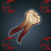 **Variant 3: Dodge This, Deaders!** (Complete Area 175)
> Morte starts in the formation with Give 'em the Laugh unlocked. He can be moved, but not removed.  
> You may only use a maximum of five Champions in your formation who do not have the Debuff role. If you have more than five, the damage of all Champions is set to 0.  
> All enemies move 300% faster and deal 40% of their target's max health with each successful hit.  
> <b>Getting to Know Morte:</b> Morte can evade attacks entirely with his Give 'em the Laugh ability. He recovers Evasion stacks faster for each Debuff Champion in the formation, but his max Evasion stacks are higher for each non-Debuff Champion.

# Other Champion Images

    
        
            Console Portrait
        
    
    
        
            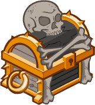Gold Chest Icon
        
        
            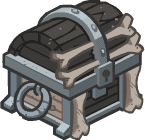Silver Chest Icon
        
    

[Back to Top](#top)

*Last Modified: {{ site.time }}*