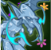

[Back to Main](index.md)

    
        
            
        
        
            Portrait
        
    

# Gazrick

Gazrick Nomrad is just your standard gnome druid/businessman/detective/chef/socialist construct. Harnessing the magic of all things cold, he brings a wealth of frost-based spells to the table, as well as insisting his actions are not weird. They are.

# Changes

Gazrick will be a reworked champion in the Wintershield event on 6 January 2027.

Only abilities that have seen some changes will be displayed here - and be aware that there's a lot of guesswork involved. Some abilities may not have names - some may have the *wrong* names - or specialisations might not be marked as such - etc.. Focus on the effect data itself.

Please do me a favour and don't get all melodramatic about what you find here. I - and CNE - don't appreciate it. These are spoilers and will almost certainly change before release - likely multiple times. That and we don't have access to any upgrade data prior to release. Making assumptions on how the champions will turn out based on this information would be premature.

# Specialisations

**Specialisation: Sheer Cold** (Guess)
> Unknown.

<em>Raw Data</em>

<pre>
{
    "id": 31706,
    "graphic": "Icons/Events/2017Wintershield/Wintershield_Y10/Icon_Specialization_Gazrick_SheerCold",
    "v": 2,
    "fs": 0,
    "p": 0,
    "type": 1,
    "export_params": {
        "uses": [
            "icon"
        ],
        "quantize": true
    }
}
</pre>

**Specialisation: Stay Frosty** (Guess)
> Unknown.

<em>Raw Data</em>

<pre>
{
    "id": 31707,
    "graphic": "Icons/Events/2017Wintershield/Wintershield_Y10/Icon_Specialization_Gazrick_StayFrosty",
    "v": 2,
    "fs": 0,
    "p": 0,
    "type": 1,
    "export_params": {
        "uses": [
            "icon"
        ],
        "quantize": true
    }
}
</pre>

# Adventures and Variants

**Unlock Adventure: The Endless War (Gazrick)** (Complete Area 50)
> Defend Triboar from a Githyanki invasion.

 **Variant 1: Cool Comrades** (Complete Area 75)
> Gazrick starts in the formation. He can't be moved or removed from the formation.  
> Two Ice Mephits have befriended Gazrick. It's not weird.  
> Getting to know Gazrick: Gazrick's main support ability gets stronger with distance in a straight line. Place your damage dealers to get the most out of Gazrick's buffs!

 **Variant 2: Brain Freeze** (Complete Area 125)
> Gazrick starts in the formation. He can't be moved or removed from the formation.  
> Gazrick has created three Snow Golems companions. Each Golem has an intellect devourer perched on their head. It's not weird.  
> Only Champions with an INT score of 13 or higher can be used.  
> It's snowing in all areas where there is not already weather set.  
> Getting to know Gazrick: Gazrick's main support ability can still support through gaps in the formation. Place your damage dealers to get the most out of Gazrick's buffs!

 **Variant 3: Armored Assault** (Complete Area 175)
> Gazrick starts in the formation. He can be moved, but he can't be removed. His Armor Ablation ability starts unlocked.  
> All boss enemies have at least 25 armored health.  
> Armored enemies require 100% more damage to deal one armored hit.  
> Gazrick's Armor Ablation ability is +100% more effective.  
> Getting to Know Gazrick: Gazrick's attacks can weaken armor. Use his specialization and increase his attack speed to make the most of this feature!

# Formation

    <svg xmlns="http://www.w3.org/2000/svg" id="Gazrick" fill="#aaa" data-formationName="Gazrick" data-campaignName="Wintershield" width="341" height="160"><circle cx="215" cy="45" r="15"/><circle cx="175" cy="65" r="15"/><circle cx="175" cy="105" r="15"/><circle cx="135" cy="85" r="15"/><circle cx="95" cy="65" r="15"/><circle cx="55" cy="45" r="15"/><circle cx="15" cy="25" r="15"/><circle cx="15" cy="65" r="15"/><circle cx="15" cy="105" r="15"/><circle cx="15" cy="145" r="15"/><text x="245" y="25" fill="#dcdcdc" font-size="25" font-family="Arial" font-weight="bold">Gazrick</text><text x="245" y="65" fill="#dcdcdc" font-size="15" font-family="Arial" font-weight="bold">Wintershield</text></svg>

[Back to Top](#top)

*Last Modified: {{ site.time }}*