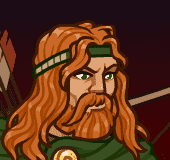
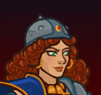
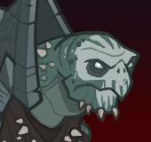
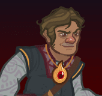
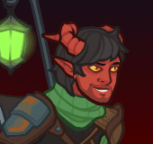
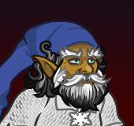

# Idle Champions Spoilers

Just a collection of most of the currently-known spoilers. It is by no means exhaustive. Of course - spoilers are subject to change at any time. Don't plan any major life events around them.

 

I'm not angry that you discuss spoilers in places you shouldn't... I'm just disappointed. Spoilers belong on the {::nomarkdown}<a href="https://discord.gg/idlechampions" target="_blank">official IC Discord</a>{:/nomarkdown} in the `#well_of_spoilers` channel only.

    <input type="checkbox" onClick="changeIndexVersion()" id="sortByEvents">
    <label class="switch" for="eventsVersion">Sort by Event Schedule</label>

{::nomarkdown}

{:/nomarkdown}

# New Event Champions

These are the new event champions that are upcoming and all the information we know about them.

{::nomarkdown}
<a href="tanis.html">
{:/nomarkdown}
    
        
            
        
        
            
                Tanthalas Half-Elven
            
            
                Half-Elf Fighter of Heroes of the Lance (Guess)
            
            
                Simril - 2 December 2026
            
        
        
            
            
        
        
            New ⭐ Roadmapped 🗺️
        
    
{::nomarkdown}
</a>
{:/nomarkdown}
{::nomarkdown}
<a href="tika.html">
{:/nomarkdown}
    
        
            
        
        
            
                Tika Waylan
            
            
                Human of Heroes of the Lance (Guess)
            
            
                Wintershield - 6 January 2027
            
        
        
            New ⭐
        
    
{::nomarkdown}
</a>
{:/nomarkdown}
{::nomarkdown}
<a href="goldmoon.html">
{:/nomarkdown}
    
        
            
        
        
            
                Goldmoon
            
            
                Human Cleric of Heroes of the Lance (Guess)
            
            
                Grand Revel - 3 February 2027
            
        
        
            New ⭐
        
    
{::nomarkdown}
</a>
{:/nomarkdown}

# Reworked & Rebalanced Champions

A list of champions that will be seeing reworks or rebalances in upcoming events.  
Events will have either one rework OR three rebalances.

{::nomarkdown}
<a href="krull.html">
{:/nomarkdown}
    
        
            
        
        
            
                Krull
            
            
                Tortle Cleric of Dark Order
            
            
                Simril - 2 December 2026
            
        
        
            
        
        
            Rebalance 🛠️ Roadmapped 🗺️
        
    
{::nomarkdown}
</a>
{:/nomarkdown}
{::nomarkdown}
<a href="regis.html">
{:/nomarkdown}
    
        
            
        
        
            
                Regis
            
            
                Halfling Rogue of Companions of the Hall
            
            
                Simril - 2 December 2026
            
        
        
            
        
        
            Rebalance 🛠️ Roadmapped 🗺️
        
    
{::nomarkdown}
</a>
{:/nomarkdown}
{::nomarkdown}
<a href="talin.html">
{:/nomarkdown}
    
        
            
        
        
            
                Talin Uran
            
            
                Tiefling Rogue
            
            
                Simril - 2 December 2026
            
        
        
            
        
        
            Rebalance 🛠️ Roadmapped 🗺️
        
    
{::nomarkdown}
</a>
{:/nomarkdown}
{::nomarkdown}
<a href="gazrick.html">
{:/nomarkdown}
    
        
            
        
        
            
                Gazrick Nomrad
            
            
                Gnome (Rock) Druid of Rivals of Waterdeep
            
            
                Wintershield - 6 January 2027
            
        
        
            
        
        
            Rebalance 🛠️
        
    
{::nomarkdown}
</a>
{:/nomarkdown}

{::nomarkdown}

{:/nomarkdown}

# Champions

These are the upcoming new and reworked/rebalanced champions and where they'll be found.  
Events will have either one rework OR three rebalances.

## Simril - 2 December 2026

{::nomarkdown}
<a href="tanis.html">
{:/nomarkdown}
    
        
            
        
        
            
                Tanthalas Half-Elven
            
            
                Half-Elf Fighter of Heroes of the Lance (Guess)
            
        
        
            New ⭐ Roadmapped 🗺️
        
        
            
            
        
    
{::nomarkdown}
</a>
{:/nomarkdown}
{::nomarkdown}
<a href="regis.html">
{:/nomarkdown}
    
        
            
        
        
            
                Regis
            
            
                Halfling Rogue of Companions of the Hall
            
        
        
            Rebalance 🛠️ Roadmapped 🗺️
        
        
            
        
    
{::nomarkdown}
</a>
{:/nomarkdown}
{::nomarkdown}
<a href="krull.html">
{:/nomarkdown}
    
        
            
        
        
            
                Krull
            
            
                Tortle Cleric of Dark Order
            
        
        
            Rebalance 🛠️ Roadmapped 🗺️
        
        
            
        
    
{::nomarkdown}
</a>
{:/nomarkdown}
{::nomarkdown}
<a href="talin.html">
{:/nomarkdown}
    
        
            
        
        
            
                Talin Uran
            
            
                Tiefling Rogue
            
        
        
            Rebalance 🛠️ Roadmapped 🗺️
        
        
            
        
    
{::nomarkdown}
</a>
{:/nomarkdown}

## Wintershield - 6 January 2027

{::nomarkdown}
<a href="tika.html">
{:/nomarkdown}
    
        
            
        
        
            
                Tika Waylan
            
            
                Human of Heroes of the Lance (Guess)
            
        
        
            New ⭐
        
    
{::nomarkdown}
</a>
{:/nomarkdown}
{::nomarkdown}
<a href="gazrick.html">
{:/nomarkdown}
    
        
            
        
        
            
                Gazrick Nomrad
            
            
                Gnome (Rock) Druid of Rivals of Waterdeep
            
        
        
            Rebalance 🛠️
        
        
            
        
    
{::nomarkdown}
</a>
{:/nomarkdown}

## Grand Revel - 3 February 2027

{::nomarkdown}
<a href="goldmoon.html">
{:/nomarkdown}
    
        
            
        
        
            
                Goldmoon
            
            
                Human Cleric of Heroes of the Lance (Guess)
            
        
        
            New ⭐
        
    
{::nomarkdown}
</a>
{:/nomarkdown}

{::nomarkdown}

{:/nomarkdown}

# Timed Misc

Miscellaneous spoilers with due dates.

* Winterfest Celebration - 2 December 2026
* [Unknown Exclusive Giveaway](platform_giveaway_797.md) - 10 December 2026
* Emergence 18 - 30 December 2026
* [Trials & Legendaries](trialsLegs.md) - ???

# Misc

Miscellaneous spoilers.

* [Exclusivity Dates](exclusivitydates.md)
* [Event Roster](event_roster.md)
* [Patron Roster](patron_roster.md)
* [Feats](feats.md)
* [Skins](skins.md)
* [Familiars](familiars.md)
* [Premium Packs and DLC](premium.md)
* [Content Drops](contentdrops.md)
* [Blessings](blessings.md)
* [Weekends](weekends.md)
* [Archive of Old Spoilers](archive.md)

[Back to Top](#top)

*Last Modified: {{ site.time }}*

