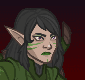
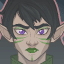

[Back to Main](index.md)

    
        
            
        
        
            Portrait
        
    

# Môrgæn

The ranger Môrgæn is a renowned tracker and hunter, able to pinpoint-target foes at any range, then vanish into the woods with no one the wiser. Her legendary ability with the longbow and the custom arrows she crafts instills fear into the hearts of her many enemies -- and more than a few of her coworkers. Famously, she is the only member of Acquisitions Incorporated known to be paid in advance, lest a missed invoice lead to dire repercussions.

# Changes

Môrgæn will be a reworked champion in the Wintershield event on 6 January 2027.

Only abilities that have seen some changes will be displayed here - and be aware that there's a lot of guesswork involved. Some abilities may not have names - some may have the *wrong* names - or specialisations might not be marked as such - etc.. Focus on the effect data itself.

Please do me a favour and don't get all melodramatic about what you find here. I - and CNE - don't appreciate it. These are spoilers and will almost certainly change before release - likely multiple times. That and we don't have access to any upgrade data prior to release. Making assumptions on how the champions will turn out based on this information would be premature.

# Abilities

**Paid Up Front** (Guess)
> Môrgæn increases the damage of all adjacent Champions by 100%. This buff is increased by 5% for each order of magnitude of gold collected while she is in the formation, stacking multiplicatively, with the total sum persisting through resets.

<em>Raw Data</em>

<pre>
{
    "id": 3157,
    "flavour_text": "",
    "description": {
        "desc": {
            "conditions": [
                {
                    "condition": "upgrade_purchased 21694",
                    "desc": "Môrgæn increases the damage of all non-adjacent Champions by $(not_buffed amount)%. This buff is increased by $amount___3% for each order of magnitude of gold collected while she is in the formation, stacking multiplicatively, with the total sum persisting through resets.^^$paid_up_front_bonus_v2"
                },
                {
                    "condition": "upgrade_purchased 21695",
                    "desc": "Môrgæn increases the damage of all Champions in front of her by $(not_buffed amount)%. This buff is increased by $amount___3% for each order of magnitude of gold collected while she is in the formation, stacking multiplicatively, with the total sum persisting through resets.^^$paid_up_front_bonus_v2"
                },
                {
                    "condition": "upgrade_purchased 21696",
                    "desc": "Môrgæn increases the damage of all Champions behind of her by $(not_buffed amount)%. This buff is increased by $amount___3% for each order of magnitude of gold collected while she is in the formation, stacking multiplicatively, with the total sum persisting through resets.^^$paid_up_front_bonus_v2"
                },
                {
                    "desc": "Môrgæn increases the damage of all adjacent Champions by $(not_buffed amount)%. This buff is increased by $amount___3% for each order of magnitude of gold collected while she is in the formation, stacking multiplicatively, with the total sum persisting through resets.^^$paid_up_front_bonus_v2"
                }
            ]
        }
    },
    "effect_keys": [
        {
            "effect_string": "hero_dps_multiplier_mult,100",
            "off_when_benched": true,
            "targets": [
                "adj"
            ],
            "show_bonus": true,
            "desc_forced_order": 2
        },
        {
            "effect_string": "morgaen_paid_up_front_v2",
            "off_when_benched": true,
            "buff_index": 2
        },
        {
            "effect_string": "buff_upgrade,5,21689,0",
            "off_when_benched": true,
            "stacks_multiply": true,
            "show_bonus": true,
            "stack_title": "Total Order of Magnitude",
            "total_title": "Gold Collected Bonus",
            "stacks_on_trigger": "will_stack_manually",
            "use_computed_amount_for_description": true,
            "desc_forced_order": 1
        }
    ],
    "requirements": [],
    "graphic_id": 7002,
    "large_graphic_id": 6999,
    "properties": {
        "is_formation_ability": true,
        "indexed_effect_properties": true,
        "per_effect_index_bonuses": true,
        "default_bonus_index": 0,
        "owner_use_outgoing_description": true
    }
}
</pre>

**Friends In Wealth** (Guess)
> Môrgæn gains a Wealth stack for each Champion in the formation with the Gold Find role. The effect of Paid Up-Front and the formation's Gold Find are both increased by 100% for each Wealth stack she has, stacking multiplicatively.

<em>Raw Data</em>

<pre>
{
    "id": 3158,
    "flavour_text": "",
    "description": {
        "desc": "Môrgæn gains a Wealth stack for each Champion in the formation with the Gold Find role. The effect of Paid Up-Front and the formation's Gold Find are both increased by $(not_buffed amount)% for each Wealth stack she has, stacking multiplicatively."
    },
    "effect_keys": [
        {
            "effect_string": "buff_upgrade,100,21689,0",
            "off_when_benched": true,
            "amount_func": "mult",
            "stack_func": "per_hero_attribute",
            "per_hero_expr": "HasTag(`gold`)",
            "show_bonus": true,
            "amount_updated_listeners": [
                "slot_changed",
                "hero_tags_changed"
            ],
            "stack_title": "Wealth Stacks"
        },
        {
            "effect_string": "gold_multiplier_mult,100",
            "off_when_benched": true,
            "amount_func": "mult",
            "stack_func": "per_hero_attribute",
            "per_hero_expr": "HasTag(`gold`)",
            "amount_updated_listeners": [
                "slot_changed",
                "hero_tags_changed"
            ],
            "show_bonus": false,
            "show_stacks": false
        }
    ],
    "requirements": [],
    "graphic_id": 7001,
    "large_graphic_id": 6998,
    "properties": {
        "is_formation_ability": true,
        "owner_use_outgoing_description": true
    }
}
</pre>

**Double Tap** (Guess)
> If neither of Môrgæn's arrows kill her target, the effect of Friends In Wealth is increased by 100%, stacking multiplicatively up to 20 times and resetting when completing a boss area.

ⓘ *Note: This ability is prestack.*

<em>Raw Data</em>

<pre>
{
    "id": 3159,
    "flavour_text": "",
    "description": {
        "desc": "If neither of Môrgæn's arrows kill her target, the effect of Friends In Wealth is increased by $amount%, stacking multiplicatively up to 20 times and resetting when completing a boss area."
    },
    "effect_keys": [
        {
            "effect_string": "pre_stack,100"
        },
        {
            "effect_string": "morgaen_double_tap_v2",
            "buff_index": 2,
            "stacks_per_attack": 1
        },
        {
            "effect_string": "buff_upgrade,0,21690",
            "off_when_benched": true,
            "stacks_multiply": true,
            "show_bonus": true,
            "amount_expr": "upgrade_amount(21691,0)",
            "stacks_on_trigger": "will_stack_manually",
            "use_computed_amount_for_description": true,
            "max_stacks": 20,
            "more_triggers": [
                {
                    "trigger": "area_changed",
                    "action": {
                        "type": "reduce_percent",
                        "percent": 100
                    }
                }
            ]
        }
    ],
    "requirements": [],
    "graphic_id": 7000,
    "large_graphic_id": 6997,
    "properties": {
        "is_formation_ability": true,
        "indexed_effect_properties": true,
        "per_effect_index_bonuses": true,
        "default_bonus_index": 0,
        "owner_use_outgoing_description": true
    }
}
</pre>

# Specialisations

**Specialisation: Fine As Is** (Guess)
> Paid Up-Front continues to only apply to adjacent Champions and if at least 4 Champions are affected by it, the effect is increased by 400% for each Champion affected by it, stacking multiplicatively.

<em>Raw Data</em>

<pre>
{
    "id": 3161,
    "flavour_text": "",
    "description": {
        "desc": "Paid Up-Front continues to only apply to adjacent Champions and if at least 4 Champions are affected by it, the effect is increased by $(not_buffed amount)% for each Champion affected by it, stacking multiplicatively."
    },
    "effect_keys": [
        {
            "effect_string": "buff_upgrade,400,21689,0",
            "off_when_benched": true,
            "show_stacks": true,
            "amount_func": "mult",
            "show_bonus": true,
            "stack_func": "per_hero_attribute",
            "stack_threshold": 3,
            "per_hero_expr": "NumUpgradeEffectsAppliedToHero(21689) > 0",
            "post_process_expr": "input * min(1, max(0, input - stack_threshold))",
            "amount_updated_listeners": [
                "slot_changed"
            ]
        }
    ],
    "requirements": [],
    "graphic_id": 0,
    "large_graphic_id": 0,
    "properties": {
        "is_formation_ability": true,
        "indexed_effect_properties": true,
        "per_effect_index_bonuses": true,
        "default_bonus_index": 0,
        "owner_use_outgoing_description": true
    }
}
</pre>

**Specialisation: Keep Your Distance** (Guess)
> Paid Up-Front now only applies to all non-adjacent Champions and if at least 5 Champions are affected by it, the effect is increased by 500% for each Champion affected by it, stacking multiplicatively.

<em>Raw Data</em>

<pre>
{
    "id": 3162,
    "flavour_text": "",
    "description": {
        "desc": "Paid Up-Front now only applies to all non-adjacent Champions and if at least 5 Champions are affected by it, the effect is increased by $(not_buffed amount___2)% for each Champion affected by it, stacking multiplicatively."
    },
    "effect_keys": [
        {
            "effect_string": "change_upgrade_targets,21689",
            "new_targets": "non_adj",
            "effect_index": 0
        },
        {
            "effect_string": "buff_upgrade,500,21689,0",
            "off_when_benched": true,
            "show_stacks": true,
            "amount_func": "mult",
            "show_bonus": true,
            "stack_func": "per_hero_attribute",
            "stack_threshold": 4,
            "per_hero_expr": "NumUpgradeEffectsAppliedToHero(21689) > 0",
            "post_process_expr": "input * min(1, max(0, input - stack_threshold))",
            "amount_updated_listeners": [
                "slot_changed"
            ]
        }
    ],
    "requirements": [],
    "graphic_id": 0,
    "large_graphic_id": 0,
    "properties": {
        "is_formation_ability": true,
        "indexed_effect_properties": true,
        "per_effect_index_bonuses": true,
        "default_bonus_index": 1,
        "owner_use_outgoing_description": true
    }
}
</pre>

**Specialisation: Monster Fodder** (Guess)
> Paid Up-Front now only applies to all Champions in front of Môrgæn and if at least 6 Champions are affected by it, the effect is increased by 600% for each Champion affected by it, stacking multiplicatively.

<em>Raw Data</em>

<pre>
{
    "id": 3163,
    "flavour_text": "",
    "description": {
        "desc": "Paid Up-Front now only applies to all Champions in front of Môrgæn and if at least 6 Champions are affected by it, the effect is increased by $(not_buffed amount___2)% for each Champion affected by it, stacking multiplicatively."
    },
    "effect_keys": [
        {
            "effect_string": "change_upgrade_targets,21689",
            "new_targets": "ahead",
            "effect_index": 0
        },
        {
            "effect_string": "buff_upgrade,600,21689,0",
            "off_when_benched": true,
            "show_stacks": true,
            "amount_func": "mult",
            "show_bonus": true,
            "stack_func": "per_hero_attribute",
            "stack_threshold": 5,
            "per_hero_expr": "NumUpgradeEffectsAppliedToHero(21689) > 0",
            "post_process_expr": "input * min(1, max(0, input - stack_threshold))",
            "amount_updated_listeners": [
                "slot_changed"
            ]
        }
    ],
    "requirements": [],
    "graphic_id": 0,
    "large_graphic_id": 0,
    "properties": {
        "is_formation_ability": true,
        "indexed_effect_properties": true,
        "per_effect_index_bonuses": true,
        "default_bonus_index": 1,
        "owner_use_outgoing_description": true
    }
}
</pre>

**Specialisation: Stay Out Of My Way** (Guess)
> Paid Up-Front now only applies to all Champions behind Môrgæn and if at least 7 Champions are affected by it, the effect is increased by 700% for each Champion affected by it, stacking multiplicatively.

<em>Raw Data</em>

<pre>
{
    "id": 3164,
    "flavour_text": "",
    "description": {
        "desc": "Paid Up-Front now only applies to all Champions behind Môrgæn and if at least 7 Champions are affected by it, the effect is increased by $(not_buffed amount___2)% for each Champion affected by it, stacking multiplicatively."
    },
    "effect_keys": [
        {
            "effect_string": "change_upgrade_targets,21689",
            "new_targets": "behind",
            "effect_index": 0
        },
        {
            "effect_string": "buff_upgrade,700,21689,0",
            "off_when_benched": true,
            "show_stacks": true,
            "amount_func": "mult",
            "show_bonus": true,
            "stack_func": "per_hero_attribute",
            "stack_threshold": 6,
            "per_hero_expr": "NumUpgradeEffectsAppliedToHero(21689) > 0",
            "post_process_expr": "input * min(1, max(0, input - stack_threshold))",
            "amount_updated_listeners": [
                "slot_changed"
            ]
        }
    ],
    "requirements": [],
    "graphic_id": 0,
    "large_graphic_id": 0,
    "properties": {
        "is_formation_ability": true,
        "indexed_effect_properties": true,
        "per_effect_index_bonuses": true,
        "default_bonus_index": 1,
        "owner_use_outgoing_description": true
    }
}
</pre>

**Specialisation: Keep It Simple** (Guess)
> The effect of Paid Up-Front is increased by 1500%.

<em>Raw Data</em>

<pre>
{
    "id": 3165,
    "flavour_text": "",
    "description": {
        "desc": "The effect of Paid Up-Front is increased by $amount%."
    },
    "effect_keys": [
        {
            "effect_string": "buff_upgrade,1500,3326"
        }
    ],
    "requirements": [],
    "graphic_id": 0,
    "large_graphic_id": 0,
    "properties": {
        "is_formation_ability": true,
        "use_outgoing_description": true
    }
}
</pre>

**Specialisation: Unknown** (Guess)
> The effect of Paid Up-Front is increased by 100% for each Champion in the formation with a DEX score of 16 or higher.

<em>Raw Data</em>

<pre>
{
    "id": 3166,
    "flavour_text": "",
    "description": {
        "desc": "The effect of Paid Up-Front is increased by $(not_buffed amount)% for each Champion in the formation with a DEX score of 16 or higher."
    },
    "effect_keys": [
        {
            "off_when_benched": true,
            "effect_string": "buff_upgrade,100,21689",
            "stack_func": "per_hero_attribute",
            "per_hero_expr": "GetStat(`dex`)>=16",
            "amount_func": "mult",
            "show_bonus": true,
            "amount_updated_listeners": [
                "slot_changed",
                "feat_changed",
                "ability_score_changed"
            ]
        }
    ],
    "requirements": [],
    "graphic_id": 0,
    "large_graphic_id": 0,
    "properties": {
        "is_formation_ability": true,
        "owner_use_outgoing_description": true,
        "formation_circle_icon": false,
        "indexed_effect_properties": true,
        "per_effect_index_bonuses": true,
        "default_bonus_index": 0,
        "spec_option_post_apply_info": "High Dexterity Champions: $num_stacks"
    }
}
</pre>

**Specialisation: Unknown** (Guess)
> The effect of Paid Up-Front is increased by 100% for each Champion in the formation with a CHA score of 12 or lower.

<em>Raw Data</em>

<pre>
{
    "id": 3167,
    "flavour_text": "",
    "description": {
        "desc": "The effect of Paid Up-Front is increased by $(not_buffed amount)% for each Champion in the formation with a CHA score of 12 or lower."
    },
    "effect_keys": [
        {
            "off_when_benched": true,
            "effect_string": "buff_upgrade,100,21689",
            "stack_func": "per_hero_attribute",
            "per_hero_expr": "GetStat(`cha`)<=12",
            "amount_func": "mult",
            "show_bonus": true,
            "amount_updated_listeners": [
                "slot_changed",
                "feat_changed",
                "ability_score_changed"
            ]
        }
    ],
    "requirements": [],
    "graphic_id": 0,
    "large_graphic_id": 0,
    "properties": {
        "is_formation_ability": true,
        "owner_use_outgoing_description": true,
        "formation_circle_icon": false,
        "indexed_effect_properties": true,
        "per_effect_index_bonuses": true,
        "default_bonus_index": 0,
        "spec_option_post_apply_info": "Low Charisma Champions: $num_stacks"
    }
}
</pre>

**Specialisation: Unknown** (Guess)
> The effect of Paid Up-Front is increased by 100% for each Champion in the formation from the Acquisitions Incorporated or The "C"-Team affiliations.

<em>Raw Data</em>

<pre>
{
    "id": 3168,
    "flavour_text": "",
    "description": {
        "desc": "The effect of Paid Up-Front is increased by $(not_buffed amount)% for each Champion in the formation from the Acquisitions Incorporated or The \"C\"-Team affiliations."
    },
    "effect_keys": [
        {
            "off_when_benched": true,
            "effect_string": "buff_upgrade,100,21689",
            "stack_func": "per_hero_attribute",
            "per_hero_expr": "HasTag(`acqinc`) || HasTag(`cteam`)",
            "amount_func": "mult",
            "show_bonus": true,
            "amount_updated_listeners": [
                "slot_changed",
                "feat_changed",
                "ability_score_changed"
            ]
        }
    ],
    "requirements": [],
    "graphic_id": 0,
    "large_graphic_id": 0,
    "properties": {
        "is_formation_ability": true,
        "owner_use_outgoing_description": true,
        "formation_circle_icon": false,
        "indexed_effect_properties": true,
        "per_effect_index_bonuses": true,
        "default_bonus_index": 0,
        "spec_option_post_apply_info": "Affiliated Champions: $num_stacks"
    }
}
</pre>

**Specialisation: Unknown** (Guess)
> Increases the effect of Regis' Ruby Encouragement ability by 100% for each goblin Champion in the formation, stacking additively.

<em>Raw Data</em>

<pre>
{
    "id": 3169,
    "flavour_text": "",
    "description": {
        "desc": "Increases the effect of Regis' Ruby Encouragement ability by $(amount)% for each goblin Champion in the formation, stacking additively"
    },
    "effect_keys": [
        {
            "off_when_benched": true,
            "effect_string": "buff_upgrades,100,21593,21594",
            "amount_func": "add",
            "stack_func": "per_hero_attribute",
            "show_bonus": true,
            "per_hero_expr": "HasTag(`goblin`)",
            "amount_updated_listeners": [
                "slot_changed",
                "hero_tags_changed"
            ]
        }
    ],
    "requirements": "",
    "graphic_id": 0,
    "large_graphic_id": 0,
    "properties": {
        "is_formation_ability": true,
        "effect_name": "Goblin Glitch",
        "show_in_owner_outgoing": true,
        "owner_use_outgoing_description": true,
        "indexed_effect_properties": true,
        "per_effect_index_bonuses": true,
        "default_bonus_index": 0
    }
}
</pre>

# Adventures and Variants

 **Unlock Adventure: Deadwinter Day (Môrgæn)** (Complete Area 50)
> Patrol the outskirts of Longsaddle on Deadwinter Day.

 **Variant 1: Utterly Devoured** (Complete Area 75)
> Champions devoured by the Devourer are devoured forever and can not be used again until you reset.

 **Variant 2: Limited Resources** (Complete Area 125)
> Only Champions in the first bench seat are initially available. Every 10 areas another bench seat unlocks.

 **Variant 3: Careful Positioning** (Complete Area 175)
> Môrgæn starts in the formation and can not be removed or swapped out. Only Môrgæn and Champions buffed by Paid Up-Front can deal damage.

# Formation

    <svg xmlns="http://www.w3.org/2000/svg" id="Môrgæn" fill="#aaa" data-formationName="Môrgæn" data-campaignName="Wintershield" width="308" height="160"><circle cx="175" cy="65" r="15"/><circle cx="135" cy="85" r="15"/><circle cx="135" cy="125" r="15"/><circle cx="95" cy="65" r="15"/><circle cx="95" cy="105" r="15"/><circle cx="95" cy="145" r="15"/><circle cx="55" cy="45" r="15"/><circle cx="55" cy="85" r="15"/><circle cx="15" cy="25" r="15"/><circle cx="15" cy="105" r="15"/><text x="205" y="25" fill="#dcdcdc" font-size="25" font-family="Arial" font-weight="bold">Môrgæn</text><text x="205" y="65" fill="#dcdcdc" font-size="15" font-family="Arial" font-weight="bold">Wintershield</text></svg>

[Back to Top](#top)

*Last Modified: {{ site.time }}*