[Back to Main](index.md)

# Skins

Skins that are upcoming. Most skins are real money purchases only.

ⓘ *Note: The skin portraits have tooltips which can include an animated model. Skin models can sometimes exist even when the portrait does not. A ❌ indicates a skin with a portrait but no model - while a ✔️ indicates a skin with a model but no portrait.*

    
        
            ID: 740**Ice Queen Minthara (Minthara)**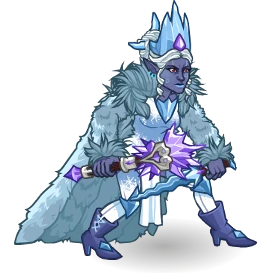
        
        
            Ice Queen Minthara
        
        
            Ice Queen Minthara Skin & Feat Pack
        
        
            1,680p
        
        
            11 Nov 2026
        
    
    
        
            ID: 741**Starlit Sentry (Sentry)**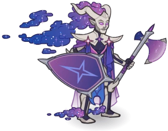
        
        
            Starlit Sentry
        
        
            Starlit Sentry Skin & Feat Pack
        
        
            1,680p
        
        
            11 Nov 2026
        
    
    
        
            ID: 742**Frostbite Skylla (Skylla)**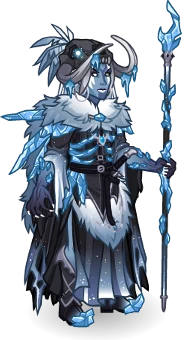
        
        
            Frostbite Skylla
        
        
            Frostbite Skylla Skin & Feat Pack
        
        
            1,680p
        
        
            18 Nov 2026
        
    
    
        
            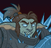ID: 771**Frostbite Lazaapz (Lazaapz)**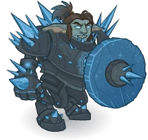
        
        
            Frostbite Lazaapz
        
        
            Frostbite Lazaapz Skin & Feat Pack
        
        
            1,680p
        
        
            25 Nov 2026
        
    
    
        
            ID: 765**Dragon Army Tanis (Tanis)**
        
        
            Dragon Army Tanis
        
        
            Dragon Army Tanis Theme Pack
        
        
            3,830p
        
        
            02 Dec 2026
        
    
    
        
            ID: 756**Gladiator Krull (Krull)**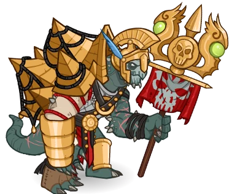
        
        
            Gladiator Krull
        
        
            Gladiator Krull Skin & Feat Pack
        
        
            1,680p
        
        
            02 Dec 2026
        
    
    
        
            ID: 757**Regis Goblin Shaman Kllug (Regis)**
        
        
            Regis Goblin Shaman Kllug
        
        
            Regis Goblin Shaman Kllug Skin & Feat Pack
        
        
            1,680p
        
        
            02 Dec 2026
        
    
    
        
            ID: 758**Infernal Shadowheart (Shadowheart)**
        
        
            Infernal Shadowheart
        
        
            Infernal Shadowheart Skin & Feat Pack
        
        
            1,680p
        
        
            09 Dec 2026
        
    
    
        
            ID: 764**Snow Day Diana (Diana)**
        
        
            Snow Day Diana
        
        
            Snow Day Diana Holiday Pack
        
        
            $24.99
        
        
            10 Dec 2026
        
    
    
        
            ID: 759**Feywild Fairytale Yorven (Yorven)**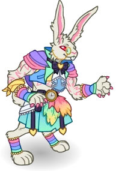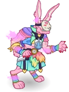
        
        
            Feywild Fairytale Yorven
        
        
            Feywild Fairytale Yorven Skin & Feat Pack
        
        
            1,680p
        
        
            16 Dec 2026
        
    
    
        
            ID: 772**Snow Day Hank (Hank)**
        
        
            Snow Day Hank
        
        
            Snow Day Hank Skin & Feat Pack
        
        
            1,680p
        
        
            23 Dec 2026
        
    
    
        
            ID: 766**Inn of the Last Home Tika (Tika)**
        
        
            Inn of the Last Home Tika
        
        
            Inn of the Last Home Tika Theme Pack
        
        
            3,830p
        
        
            06 Jan 2027
        
    
    
        
            ID: 767**Wintershield Knight Barrowin (Barrowin)**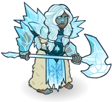✔️
        
        
            Wintershield Knight Barrowin
        
        
            Wintershield Knight Barrowin Skin & Feat Pack
        
        
            1,680p
        
        
            06 Jan 2027
        
    
    
        
            ID: 768**Wintershield Knight Eric (Eric)**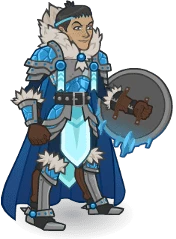
        
        
            Wintershield Knight Eric
        
        
            Wintershield Knight Eric Skin & Feat Pack
        
        
            1,680p
        
        
            13 Jan 2027
        
    
    
        
            ID: 769**Wintershield Knight Gazrick (Gazrick)**
        
        
            Wintershield Knight Gazrick
        
        
            Wintershield Knight Gazrick Skin & Feat Pack
        
        
            1,680p
        
        
            13 Jan 2027
        
    
    
        
            ID: 770**Wintershield Knight Rust (Rust)**
        
        
            Wintershield Knight Rust
        
        
            Wintershield Knight Rust Skin & Feat Pack
        
        
            1,680p
        
        
            20 Jan 2027
        
    
    
        
            ID: 774**Autumn Twilight Bride Goldmoon (Goldmoon)**
        
        
            Autumn Twilight Bride Goldmoon
        
        
            Autumn Twilight Bride Goldmoon Theme Pack
        
        
            3,830p
        
        
            03 Feb 2027
        
    
    
        
            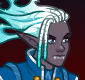ID: 775**Meteor Duelist Fen (Fen)**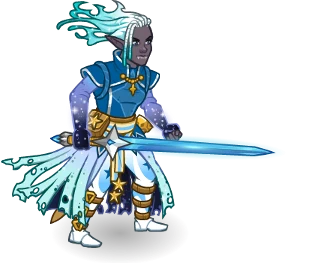
        
        
            Meteor Duelist Fen
        
        
            Meteor Duelist Fen Skin & Feat Pack
        
        
            1,680p
        
        
            03 Feb 2027
        
    
    
        
            ID: 776**Radiant Gala Karlach (Karlach)**
        
        
            Radiant Gala Karlach
        
        
            Radiant Gala Karlach Skin & Feat Pack
        
        
            1,680p
        
        
            03 Feb 2027
        
    
    
        
            ID: 777**Clockwork Cosmos Vi (Vi)**
        
        
            Clockwork Cosmos Vi
        
        
            Clockwork Cosmos Vi Skin & Feat Pack
        
        
            1,680p
        
        
            10 Feb 2027
        
    
    
        
            ID: 778**Lunar Vestments Kalix (Kalix)**
        
        
            Lunar Vestments Kalix
        
        
            Lunar Vestments Kalix Skin & Feat Pack
        
        
            1,680p
        
        
            10 Feb 2027
        
    
    
        
            ID: 779**Stargazer Presto (Presto)**
        
        
            Stargazer Presto
        
        
            Stargazer Presto Skin & Feat Pack
        
        
            1,680p
        
        
            17 Feb 2027
        
    

[Back to Top](#top)

*Last Modified: {{ site.time }}*