[Back to Main](index.md)

    
        
            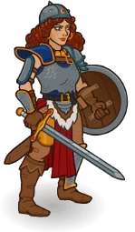
        
        
            Model
        
    

# Tika Waylan

[Tika Waylan - Dragonlace Fandom Wiki](https://dragonlance.fandom.com/wiki/Tika_Waylan){:target="_blank"}

# Basic Information

Tika Waylan will be a new champion in the Wintershield event on 6 January 2027.

  **Seat**:
  Unknown
  **Species**:
  Human (Guess)
  **Class**:
  Unknown
  **Roles**:
  Unknown
  **Age**:
  Unknown
  **Gender**:
  Female (Guess)
  **Alignment**:
  Unknown
  **Affiliation**:
  Heroes of the Lance (Guess)

# Formation

Unknown.


    



# Attacks

Unknown.

# Abilities

**Adaptive Training** (Guess)
> Unknown effect.

<em>Raw Data</em>

<pre>
{
    "id": 31703,
    "graphic": "Icons/Events/2017Wintershield/Wintershield_Y10/Icon_Formation_Tika_AdaptiveTraining",
    "v": 2,
    "fs": 0,
    "p": 0,
    "type": 1,
    "export_params": {
        "uses": [
            "icon"
        ],
        "quantize": true
    }
}
</pre>

**Order Up** (Guess)
> Unknown effect.

<em>Raw Data</em>

<pre>
{
    "id": 31704,
    "graphic": "Icons/Events/2017Wintershield/Wintershield_Y10/Icon_Formation_Tika_OrderUp",
    "v": 2,
    "fs": 0,
    "p": 0,
    "type": 1,
    "export_params": {
        "uses": [
            "icon"
        ],
        "quantize": true
    }
}
</pre>

**Spirited Defiance** (Guess)
> Unknown effect.

<em>Raw Data</em>

<pre>
{
    "id": 31705,
    "graphic": "Icons/Events/2017Wintershield/Wintershield_Y10/Icon_Formation_Tika_SpiritedDefiance",
    "v": 2,
    "fs": 0,
    "p": 0,
    "type": 1,
    "export_params": {
        "uses": [
            "icon"
        ],
        "quantize": true
    }
}
</pre>

# Specialisations

**Excellent Service** (Guess)
> Unknown effect.

<em>Raw Data</em>

<pre>
{
    "id": 31708,
    "graphic": "Icons/Events/2017Wintershield/Wintershield_Y10/Icon_Specialization_Tika_ExcellentService",
    "v": 2,
    "fs": 0,
    "p": 0,
    "type": 1,
    "export_params": {
        "uses": [
            "icon"
        ],
        "quantize": true
    }
}
</pre>

**Fast Food** (Guess)
> Unknown effect.

<em>Raw Data</em>

<pre>
{
    "id": 31709,
    "graphic": "Icons/Events/2017Wintershield/Wintershield_Y10/Icon_Specialization_Tika_FastFood",
    "v": 2,
    "fs": 0,
    "p": 0,
    "type": 1,
    "export_params": {
        "uses": [
            "icon"
        ],
        "quantize": true
    }
}
</pre>

**Home Cooking** (Guess)
> Unknown effect.

<em>Raw Data</em>

<pre>
{
    "id": 31711,
    "graphic": "Icons/Events/2017Wintershield/Wintershield_Y10/Icon_Specialization_Tika_HomeCooking",
    "v": 2,
    "fs": 0,
    "p": 0,
    "type": 1,
    "export_params": {
        "uses": [
            "icon"
        ],
        "quantize": true
    }
}
</pre>

**Hearty Heroes** (Guess)
> Unknown effect.

<em>Raw Data</em>

<pre>
{
    "id": 31710,
    "graphic": "Icons/Events/2017Wintershield/Wintershield_Y10/Icon_Specialization_Tika_HeartyHeroes",
    "v": 2,
    "fs": 0,
    "p": 0,
    "type": 1,
    "export_params": {
        "uses": [
            "icon"
        ],
        "quantize": true
    }
}
</pre>

**Hometown Heroes** (Guess)
> Unknown effect.

<em>Raw Data</em>

<pre>
{
    "id": 31712,
    "graphic": "Icons/Events/2017Wintershield/Wintershield_Y10/Icon_Specialization_Tika_HometownHeroes",
    "v": 2,
    "fs": 0,
    "p": 0,
    "type": 1,
    "export_params": {
        "uses": [
            "icon"
        ],
        "quantize": true
    }
}
</pre>

**Humble Heroes** (Guess)
> Unknown effect.

<em>Raw Data</em>

<pre>
{
    "id": 31713,
    "graphic": "Icons/Events/2017Wintershield/Wintershield_Y10/Icon_Specialization_Tika_HumbleHeroes",
    "v": 2,
    "fs": 0,
    "p": 0,
    "type": 1,
    "export_params": {
        "uses": [
            "icon"
        ],
        "quantize": true
    }
}
</pre>

# Items

    
        
            **Icons**
        
        
            **Name**
        
    
    
        
            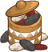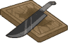
        
        
            Memories
        
    
    
        
            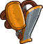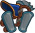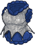
        
        
            Mismatched Armor
        
    
    
        
            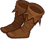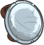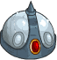
        
        
            Other Armor
        
    
    
        
            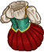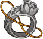
        
        
            Story Connection
        
    
    
        
            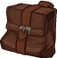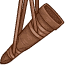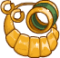
        
        
            Things
        
    
    
        
            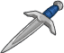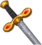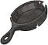
        
        
            Weapon
        
    

# Feats

Unknown.

# Legendaries

Unknown.

# Adventures and Variants

Unknown.

# Other Champion Images

    
        
            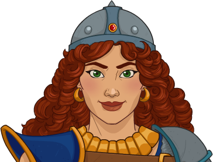Console Portrait
        
    
    
        
            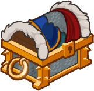Gold Chest Icon
        
        
            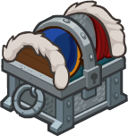Silver Chest Icon
        
    

[Back to Top](#top)

*Last Modified: {{ site.time }}*