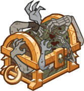

[Back to Main](index.md)

# Upcoming Weekends

Here are the upcoming weekends with their *estimated* dates - the *estimated* purchase reward - and the current expected champions.

    
        
            
            ID: 848**Gold Clawed Chest**Loot for: Asharra, Jarlaxle, Briv, Lae'zel and Brig<code>"for_crusaders":[6,4,58,128,90]</code>
        
        
            
                
                    **Rise of Undeath**
                
                
                    30 October 2026
                
            
            
                
                    
                        Assumed Reward:
                    
                    
                        Golden Epic for Brig
                    
                
                
                    
                        Asharra
                        ID: 6**Asharra**Increases the effect of Asharra's Bond: Dwarves and Elves, Bond: Exotic Species, Bond: Half n' Half, Bond: Humans, Bond: Potpourri and Bond: Short-folk by 200%.<code>buff_upgrades,200,91,976,975,90,92,977</code>
                    
                    
                        Jarlaxle
                        ID: 4**Jarlaxle Baenre**Increases the effect of Jarlaxle's Master of Disguise and Master of Piracy by 200%.<code>buff_upgrades,200,52,2188</code>
                    
                    
                        Briv
                        ID: 58**Briv Steelmarrow**
                    
                    
                        Lae'zel
                        ID: 128**Lae'zel**Increases the effect of Lae'zel's Lethal Coordination ability by 200%.<code>buff_upgrade,200,12113</code>
                    
                    
                        Brig
                        ID: 90**Brig Hellclaw**
                    
                
            
        
    
    
        
            
            ID: 852**Gold Revelry Chest**Loot for: Nayeli, Bruenor, Donaar, Nordom and Morte<code>"for_crusaders":[3,1,34,100,181]</code>
        
        
            
                
                    **Heroes Parade**
                
                
                    06 November 2026
                
            
            
                
                    
                        Assumed Reward:
                    
                    
                        Golden Epic for Morte
                    
                
                
                    
                        Nayeli
                        ID: 3**Nayeli Goldflower**Increases the effect of Nayeli's Aura of Courage ability by 200%.<code>buff_upgrade,200,38</code>
                    
                    
                        Bruenor
                        ID: 1**Bruenor Battlehammer**Increases the effect of Bruenor's Rally ability by 200%.<code>buff_upgrade,200,4</code>
                    
                    
                        Donaar
                        ID: 34**Donaar Blit'zen**
                    
                    
                        Nordom
                        ID: 100**Nordom Whistleklik**
                    
                    
                        Morte
                        ID: 181**Mortimer Rictusgrin**
                    
                
            
        
    
    
        
            
            ID: 853**Gold All Star Chest**Loot for: Tyril, Celeste, Kalix, Strongheart and Turiel<code>"for_crusaders":[10,2,158,126,49]</code>
        
        
            
                
                    **All Star**
                
                
                    13 November 2026
                
            
            
                
                    
                        Assumed Reward:
                    
                    
                        Golden Epic for Turiel
                    
                
                
                    
                        Tyril
                        ID: 10**Tyril Tallguy**Increases the effect of Tyril's Moonbeam and Wild Inspiration by 200%.<code>buff_upgrades,200,145,344</code>
                    
                    
                        Celeste
                        ID: 2**Celeste**Increases the effect of Celeste's Crusader's Mantle ability by 200%.<code>buff_upgrade,200,24</code>
                    
                    
                        Kalix
                        ID: 158**Kalix**Increases the effect of Kalix's Chameleon Carapace and Unorthodox Alliance by 200%. (Prestack)<code>buff_upgrades,200,16519,16518</code>
                    
                    
                        Strongheart
                        ID: 126**Strongheart**
                    
                    
                        Turiel
                        ID: 49**Turiel**
                    
                
            
        
    
    
        
            
            ID: 854**Gold Starlit Chest**Loot for: Minsc, Arkhan, Artemis, Valentine and Jang Sao<code>"for_crusaders":[7,12,54,103,140]</code>
        
        
            
                
                    **Starlight**
                
                
                    20 November 2026
                
            
            
                
                    
                        Assumed Reward:
                    
                    
                        Golden Epic for Jang Sao
                    
                
                
                    
                        Minsc
                        ID: 7**Minsc**Increases the effect of Minsc's Favored Enemy: Beasts, Favored Enemy: Fey, Favored Enemy: Humanoids, Favored Enemy: Monstrosities and Favored Enemy: Undead by 200%.<code>buff_upgrades,200,109,111,108,112,110</code>
                    
                    
                        Arkhan
                        ID: 12**Arkhan**Increases the effect of Arkhan's Bulk Up and Usurped Power by 200%.<code>buff_upgrades,200,243,244</code>
                    
                    
                        Artemis
                        ID: 54**Artemis Entreri**Increases the effect of Artemis's Observance ability by 200%.<code>buff_upgrade,200,3267</code>
                    
                    
                        Valentine
                        ID: 103**Valentine**
                    
                    
                        Jang Sao
                        ID: 140**Jang Sao**
                    
                
            
        
    
    
        
            
            ID: 855**Gold Friendly Chest**Loot for: Makos, Celeste, BBEG, Shandie and Penelope<code>"for_crusaders":[9,2,125,47,71]</code>
        
        
            
                
                    **Friendly**
                
                
                    27 November 2026
                
            
            
                
                    
                        Assumed Reward:
                    
                    
                        Golden Epic for Penelope
                    
                
                
                    
                        Makos
                        ID: 9**Makos**Increases the effect of Makos's Dark Blessing and Dark Luck by 200%.<code>buff_upgrades,200,140,139</code>
                    
                    
                        Celeste
                        ID: 2**Celeste**Increases the effect of Celeste's Crusader's Mantle ability by 200%.<code>buff_upgrade,200,24</code>
                    
                    
                        BBEG
                        ID: 125**Bartholemew Beelzebub Ezekiel Grubbe**
                    
                    
                        Shandie
                        ID: 47**Shandie**Increases the effect of Shandie's Agile Allies and Explosive Arrow by 200%.<code>buff_upgrades,200,9727,9729</code>
                    
                    
                        Penelope
                        ID: 71**Penelope**
                    
                
            
        
    

[Back to Top](#top)

*Last Modified: {{ site.time }}*